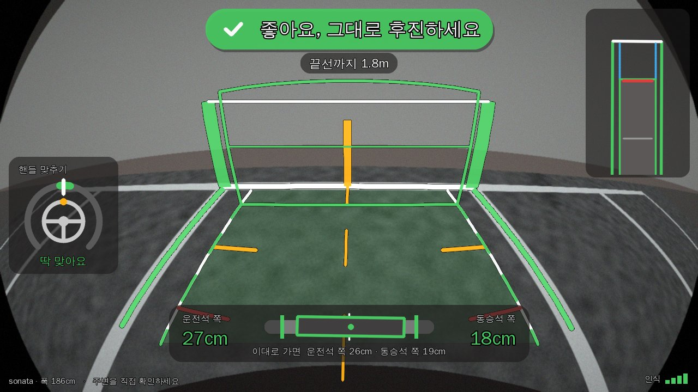
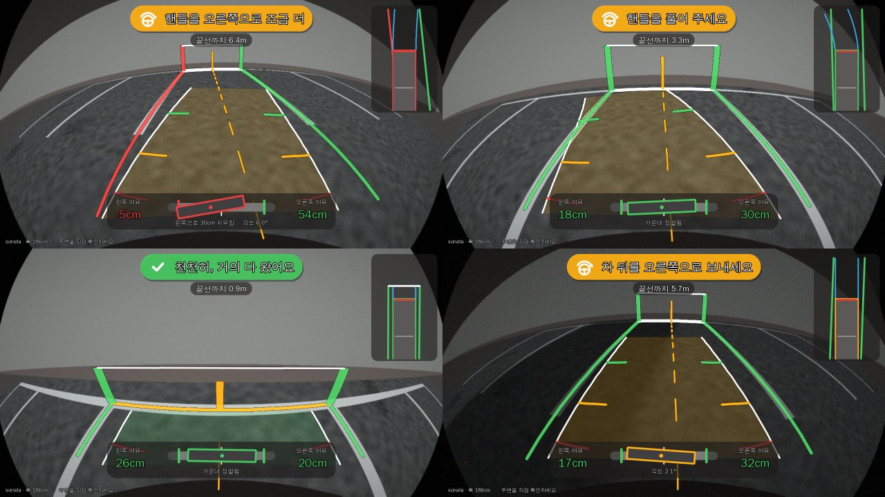
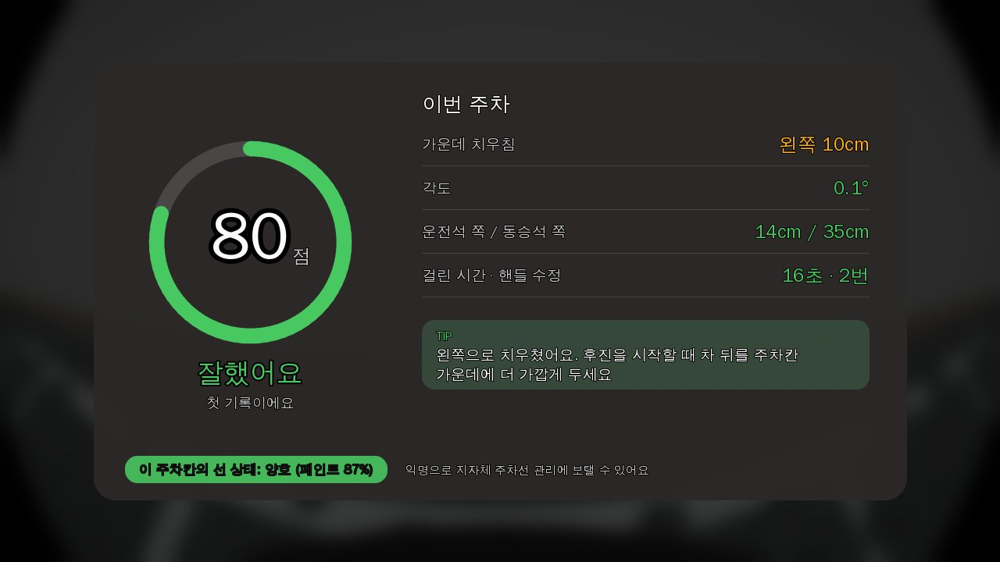

# 후방 주차 가이드 (Parking Guide): 비전 프로토타입

공주시는 후진 주차를 돕기 위해 주차칸 끝 벽에 **수직 주차선**을 페인트로 칠해 두었다.
이 프로젝트는 벽에 일일이 칠하는 대신, 후진할 때 **후방카메라 화면에서 주차선을 인식해 가상의 수직 기준선을 그린다**.
그 위에 차폭 기준 **좌우 균형**과 **핸들을 얼마나 돌릴지**를 알려 주고, 주차가 끝나면 **리포트 카드**로 실력을 키워 준다.
주차할 때마다 모이는 **주차선 상태 데이터**는 익명으로 지자체 주차선 관리에 보탤 수 있다.

최종 목표는 현대자동차·기아의 **Pleos Playground**(Android Automotive 기반 차량 앱 플랫폼)용 앱이다.
이 폴더는 그 핵심인 영상 처리와 안내 로직을 Python + OpenCV로 먼저 검증하는 프로토타입이다.



## 기존 후방카메라 가이드와 다른 점

| 기존 | 이 앱 |
|---|---|
| 핸들에 따라 휘는 선만 보여 줌 | "핸들을 오른쪽으로 **반 바퀴** 더" + **핸들 맞추기 다이얼** + 음성 안내 |
| 지금 경로만 보여 줌 | **멈출 자리(고스트카)**와 그때의 좌우 여유를 미리 보여 줌, 안 되면 "**다시 넣으세요**" |
| 목표는 늘 선 가운데 | 문 열 공간까지 생각한 목표 (**문콕 방지 하차 모드**) |
| 인식이 틀려도 그대로 표시 | **신뢰도**가 낮으면 안내를 멈추고 직접 확인을 요청 |
| 주차하면 끝 | **리포트 카드**로 실력이 늘고, 주차선 상태는 **지자체 관리 데이터**가 됨 |

회차별 고민과 결정 과정은 [docs/IMPROVEMENTS.md](docs/IMPROVEMENTS.md)에 있다.



## 화면 구성

운전 중에 한눈에 볼 수 있도록 정보를 몇 곳에만 모았다. 색만으로 구분하지 않도록 아이콘과 문구를 항상 함께 쓴다.

| 위치 | 내용 |
|---|---|
| 위 가운데: **안내 배지** | 지금 할 행동 하나. 🟡 "핸들을 오른쪽으로 1/4바퀴 더" / 🟢 "좋아요, 그대로 후진하세요" / ↻ "앞으로 나갔다가 다시 넣으세요" / 🔴 "멈추세요" / ⚪ "주차선이 희미해요". 아래에 "끝선까지 1.8m" |
| 왼쪽: **핸들 맞추기 다이얼** | 흰 바늘(지금 핸들)을 초록 구간(목표)에 넣으면 "딱 맞아요" |
| 아래 가운데: **균형 게이지** | 주차칸 안에서 차의 위치를 수평계처럼 보여 준다. 운전석 쪽·동승석 쪽 여유(cm), 예상 최종 위치(빈 윤곽), "이대로 가면 운전석 쪽 24cm · 동승석 쪽 21cm" |
| 오른쪽 위: **미니맵** | 위에서 본 주차칸, 끝선, 차, 예상 경로 |
| 오른쪽 아래: **인식 신뢰도** | 신호 막대 4칸 |

카메라 영상 위에는 다음을 그린다.
- **가상 벽 수직선**: 공주시 벽 페인트 선을 대신한다.
- **주차선 강조**: 초록 / 노랑 / 빨강.
- **차폭 통로**: 0.5·1·2m 눈금.
- **고스트카**: 끝선 2.5m 안쪽에서, 지금 핸들 그대로 가면 멈출 자리.

## 안내 로직

- **멀리서 (끝선 2.5m 밖)**: 뒷바퀴 축이 목표선 위의 점(2.5m 앞)을 향하게 하는 핸들 각도를 구한다(pure pursuit). 한쪽으로 꺾었다 푸는 S자 조작을 자연스럽게 안내한다.
- **마무리 구간 (2.5m 안)**: "지금 핸들 유지"를 가정하고, 고스트카와 같은 모델로 가장 반듯하게 멈추는 핸들 각도를 찾는다. 차를 옆으로 옮길 수 없는 거리이므로 비뚤어짐에 큰 가중치를 준다. 어떤 각도로도 선 안에 못 들어가면 "다시 넣으세요"를 띄운다.
- **바퀴 수 표현**: 30° 미만이면 그대로 두고, 그 이상은 살짝 / 1/4바퀴 / 반 바퀴 / 3/4바퀴 / 한 바퀴로 말한다.
- **하차 모드**: 반대쪽 8cm 이상을 남기는 범위에서 목표선을 최대 15cm 옮긴다.
- **신뢰도**: 0.45 미만이면 핸들 안내 대신 직접 확인을 요청한다. 고스트카는 0.5 이상에서만 보여 준다.
- **멈춤 안내**: 끝선 1m 안쪽에서 "천천히", 30cm 안쪽에서 "멈추세요". 끝선이 범퍼 밑으로 사라진 뒤에는 추적기가 이동 거리와 핸들 각도로 이어 간다.
- **음성과 비프음**:
  - 음성은 안내가 바뀔 때만 말하고, 최소 간격은 2.5초다. "1미터 남았어요", "50센티 남았어요"는 한 번씩만 말한다. "멈추세요"는 2초마다 반복한다.
  - 비프음은 끝선 1.5m부터 빨라지기 시작해 30cm 안쪽에서 연속음이 된다.
- **깜빡임 방지**: 안내 문구는 새 문구가 4프레임 이어질 때만 바꾼다("멈추세요"는 즉시).

폐루프 시뮬레이션 결과, 운전자가 안내를 늦게 따라가도 여러 시작 자세에서 목표 위치 기준 치우침 8~10cm, 각도 3° 이내로 주차했다(`tests/test_round2_ghost.py`, `tests/test_round3_door.py`).

## 인식 과정

1. **조감도 변환**: 렌즈 왜곡 보정(광각/어안)과 원근 보정을 `remap` 한 번으로 처리해, 위에서 본 영상(cm 단위)을 만든다.
2. **방향별 마스크**: 가로 커널 Top-hat으로 좌우 주차선을, 세로 커널 Top-hat으로 끝선을 뽑는다. 끝선 화소는 세로선 마스크에서 뺀다.
3. **선 묶기와 피팅**:
   - 허프 변환(절반 해상도)으로 한 직선 위의 페인트 조각들을 묶는다. 닳아서 점선처럼 끊긴 선도 한 선이 된다.
   - 묶인 조각의 화소 전체로, 행마다 선 중심을 구해 직선을 맞춘다.
4. **주차칸 선택**: 간격이 200~340cm이고 평행한 모든 쌍 중, 사이에 다른 평행선이 없고 차 중심에 가까우며 선 상태가 좋은 쌍을 고른다.
5. **끝선 보정**: 좌우 선과 수직인 끝선이 보이면 세 선의 각도를 함께 맞추고, 끝선까지 거리를 구한다.
6. **신뢰도와 추적**:
   - 보이는 길이, 페인트가 남은 비율, 좌우 폭 일치, 평행도, 주차칸 폭으로 신뢰도를 매긴다.
   - 추적기는 이동을 예측하고, 튀는 검출은 무시한다. 같은 다른 칸이 3프레임 이어지면 갈아탄다.

정확도(합성 장면):
- 깨끗한 선: 치우침 1cm 안팎, 각도 0.1° 안팎, 끝선 거리 5cm 안팎.
- 선 길이의 30%가 지워진 닳은 선: 2~4cm, 0.5° 안쪽.
- 50% 넘게 지워지면 못 찾거나 신뢰도가 낮게 나온다.

일반 렌즈와 광각 렌즈 모두로 테스트한다.

속도(개발 서버 CPU, Python): 인식·추적·안내 약 65ms + 화면 그리기 약 55ms / 프레임 (1280×720).

## 실행

```bash
cd parking_guide
pip install -r requirements.txt

python demo.py scenes                     # 합성 장면 8개 → output/scenes/
python demo.py --door driver scenes       # 운전석 여유(문콕 방지) 모드로
python demo.py --debug scenes             # 조감도·마스크 패널을 옆에 붙여서
python demo.py report                     # 주차 시뮬레이션 → 리포트 카드, report.json, 지자체 공유 JSON
python demo.py report --wear 0.6          # 닳은 주차장에서 (선 상태 판정 확인)
python demo.py video                      # 후진 주차 영상 (선택)
python demo.py image my_rear.jpg --fisheye --height 95 --pitch 28 --steer -90   # 실제 사진

python -m pytest -q                       # 테스트 75개
```



## 폴더 구조

```
parking_guide/
  camera.py    카메라 모델 (핀홀 / 광각 어안), 지면 ↔ 영상 ↔ 조감도 변환
  synth.py     합성 후방카메라 영상 (주차선·끝선·마모·그림자·벽·렌즈 왜곡), 정답 주차칸
  detector.py  주차선·끝선 검출, 주차칸 선택, 신뢰도, 추적기, 하차 모드, 좌우 균형
  guidance.py  예상 경로, 고스트카(최종 위치 예측), 목표 핸들 각도, 안내 문구
  voice.py     음성 안내 타이밍, 거리 비프음 간격
  report.py    주차 세션 기록, 점수·조언, 성장 기록, 지자체 공유 데이터
  pipeline.py  한 프레임 처리 흐름 (인식 → 추적 → 균형 → 안내 → 음성 → 기록)
  overlay.py   안내 배지, 다이얼, 균형 게이지, 미니맵, 고스트카, 가상 벽 수직선, 리포트 카드
  vehicles.py  현대·기아 차종별 전폭/전장/휠베이스 (참고값)
  text.py      한글 문구 그리기
demo.py        장면 / 리포트 / 영상 / 실제 사진 데모 (운전자 시뮬레이션 포함)
tests/         정확도, 경계 조건, 안내 로직, 폐루프 시뮬레이션 테스트
docs/          화면 예시, 회차별 개선 기록 (IMPROVEMENTS.md)
```

## Pleos 연동 계획

| 필요한 값 | Pleos에서 얻는 방법 (2026-11 공개 문서 기준) |
|---|---|
| 핸들 각도 | `SteeringWheel.registerSteeringWheelAngle`: **앞바퀴 조향각**(도, 왼쪽 −)을 주므로 조향비를 곱해 핸들 각도로 바꾼다 |
| 음성 안내 | Pleos Connect SDK `TextToSpeech` |
| 위치 (지자체 공유, 약 100m 단위로 반올림) | Pleos Connect SDK `FusedLocation` |
| 차폭·휠베이스 | `CarInfo`는 VIN만 제공 → VIN으로 차종을 조회하거나 사용자 설정 |
| 이동 거리 (추적·추측 항법) | AAOS `PERF_VEHICLE_SPEED` × 시간 (Pleos `Odometer`는 km 단위라 거칠다) |
| 후진(R단) 상태 | AAOS `GEAR_SELECTION` (Pleos `Gear` API는 숨김·deprecated, AAOS 속성을 쓰라고 안내) |
| 후방카메라 영상 | **공개된 카메라 API 없음**. 하드웨어 직접 접근 금지 정책이 있어 Pleos 측 문의 필요 |

`pipeline.ParkingAssistant`가 앱의 한 프레임 처리 흐름이다. **Kotlin으로 옮긴 Android Automotive 앱은 [`android/`](android/README.md)에 있다.** 빌드, Lint, JVM 테스트를 통과했고, Kotlin 인식기는 같은 합성 영상에서 Python 인식기와 같은 결과를 낸다.

## 한계와 다음 단계

- **실제 영상 검증**: 아직 합성 영상만으로 확인했다. 밤, 비, 빛 반사, 바닥 글씨·화살표, 옆 차와 그림자를 실제 영상으로 확인해야 한다.
- **카메라 보정**: 차량별 설치 높이·각도와 렌즈 계수를 바닥 체커보드로 보정해야 한다(`cv2.fisheye.calibrate`).
- **안내 문구 검증**: 안내 문구와 바퀴 수 표현이 실제 초보 운전자에게 잘 통하는지 사용자 테스트가 필요하다.
- **주차 리포트 기준**: 점수 기준과 "재도색 권장" 기준(페인트 60%)은 임의로 정한 초기값이라 실제 데이터로 맞춰야 한다.
- **지자체 공유**: 운전자 동의 절차와 전송 방식(배치, 익명 집계)을 설계해야 한다.
- **차량 제원**: `vehicles.py` 값은 참고용 근사치다.
