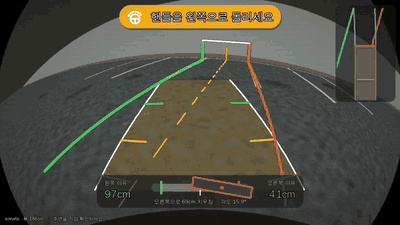

# 후방 주차 가이드 (Parking Guide): 비전 프로토타입

공주시는 후진 주차를 돕기 위해 주차칸 끝 벽에 **수직 주차선**을 페인트로 칠해 두었다.
이 프로젝트는 벽에 일일이 칠하는 대신, 후진할 때 **후방카메라 화면에서 바닥 주차선을 인식해
가상의 수직 기준선을 그려 준다**. 또 차폭을 기준으로 **좌우 균형**을 알려 주고, 핸들을 어느 쪽으로 돌려야 하는지 안내한다.

최종 목표는 현대자동차·기아의 **Pleos Playground**(Android Automotive 기반 차량 앱 플랫폼)용 앱이다.
이 폴더는 그 핵심인 영상 처리와 안내 로직을 Python + OpenCV로 먼저 검증하는 프로토타입이다.




## 화면 구성

운전 중에 한눈에 볼 수 있도록 정보를 **세 곳**에만 둔다. 색만으로 구분하지 않도록 아이콘과 문구를 항상 함께 표시한다.

| 위치 | 내용 |
|---|---|
| **위 가운데: 안내 배지** | 지금 할 행동 한 가지. 🟡 핸들 아이콘 + "핸들을 오른쪽으로 조금 더" / 🟢 ✓ "좋아요, 그대로 후진하세요" / 🔴 "멈추세요". 아래에 "끝선까지 1.8m" |
| **아래 가운데: 균형 게이지** | 수평계처럼 주차칸 안에서 차가 어디쯤 있는지 보여 준다. 양쪽에 왼쪽·오른쪽 여유(cm), 아래에 "왼쪽으로 11cm 치우침 · 각도 0.8°" |
| **오른쪽 위: 미니맵** | 위에서 본 주차칸, 끝선, 차, 예상 경로(파란 선) |

카메라 영상 위에는 다음을 그린다.

- **가상 벽 수직선**: 주차선이 끝나는 벽 쪽에 세운 세로 기준선. 공주시 벽 페인트 선을 대신한다.
- **주차선 강조**: 좌우 여유에 따라 초록(충분) / 노랑(15cm 미만) / 빨강(선 침범). 끝선은 가까워질수록 노랑을 거쳐 빨강이 된다.
- **차폭 통로**: 지금 핸들 각도로 후진하면 차가 지나갈 길. 휘어진 경로와 0.5m / 1m / 2m 눈금으로 표시한다.


## 안내 로직

- **핸들 안내**: 뒷바퀴 축이 주차칸 중심선 위의 목표점(1.5~2.5m 앞)을 향하도록 필요한 핸들 각도를 구한다(pure pursuit). 지금 핸들 각도와 30° 넘게 차이 나면 방향을 안내한다. 끝선에 가까울수록 목표점을 당겨 남은 치우침을 적극적으로 바로잡는다.
- **좌우 여유**: 접근 중에는 지금 뒷범퍼 위치 기준이다. 비스듬히 들어오는 중에 앞부분까지 직선으로 연장하면 곧 바로잡을 각도 때문에 지나치게 경고하게 된다. 끝선 2.5m 안쪽에서는 차 앞부분까지 포함한 최소 여유를 쓴다.
- **멈춤 안내**: 끝선 1m 안쪽에서는 "천천히", 30cm 안쪽에서는 "멈추세요". 끝선이 범퍼 밑으로 들어가 카메라에 안 보이는 마지막 구간은 이동 거리로 추측해 이어 간다(추측 항법).
- **깜빡임 방지**: 측정값은 지수 이동 평균으로 부드럽게 만든다. 안내 문구는 새 문구가 4프레임 이어질 때만 바꾼다. 단, "멈추세요"는 즉시 표시한다.

## 인식 과정

1. **조감도 변환**: 렌즈 왜곡 보정(광각/어안)과 원근 보정을 `remap` 한 번으로 처리해 위에서 본 영상(cm 단위)을 만든다.
2. **방향별 마스크**: 가로 커널 Top-hat으로 세로 선(좌우 주차선)을, 세로 커널 Top-hat으로 가로 선(끝선)을 뽑는다.
3. **직선 피팅**: 행(또는 열)마다 선 중심을 구해 직선을 맞춘다. 화면 경계에서 잘린 부분은 제외한다. 닳아서 끊긴 조각은 연장선 위에 있으면 합친다.
4. **주차칸 선택**: 간격이 200~340cm이고 거의 평행한 선 한 쌍 중 차 중심에 가장 가까운 쌍을 고른다.
5. **끝선 보정**: 좌우 선과 수직인 끝선이 보이면 세 선의 각도를 함께 맞춘다. 주차칸 깊숙이 들어가 좌우 선이 짧게 보일 때 특히 효과가 크다. 끝선까지 거리도 이때 구한다.

합성 장면 기준 정확도: 치우침 오차 1cm 안팎, 각도 오차 0.1~0.5°, 끝선 거리 오차 5cm 안팎. 일반 렌즈와 광각 렌즈 모두 테스트한다.
속도(개발 서버 CPU, Python): 인식 약 28ms + 화면 그리기 약 43ms / 프레임 (1280×720).

## 실행

```bash
cd parking_guide
pip install -r requirements.txt

python demo.py scenes                     # 합성 장면 7개 → output/scenes/
python demo.py --debug scenes             # 조감도·마스크 패널을 옆에 붙여서
python demo.py video                      # 후진 주차 시뮬레이션 → output/reverse_parking.mp4
python demo.py --lens pinhole video       # 일반 렌즈 카메라로
python demo.py --vehicle avante video     # 차종 바꾸기 (또는 --vehicle 185x470)
python demo.py image my_rear.jpg --fisheye --height 95 --pitch 28 --steer -90   # 실제 사진

python -m pytest -q                       # 테스트 (36개)
```

영상 데모의 운전자는 일부러 핸들을 늦게, 덜 돌리게 만들었다. 그래서 노란 안내가 뜨고, 운전자가 안내를 따르면 다시 초록으로 바뀌는 흐름을 볼 수 있다.

## 폴더 구조

```
parking_guide/
  camera.py    카메라 모델 (핀홀 / 광각 어안), 지면 ↔ 영상 ↔ 조감도 변환
  synth.py     합성 후방카메라 영상 (아스팔트, 주차선, 끝선, 마모, 그림자, 벽, 렌즈 왜곡)
  detector.py  주차선·끝선 검출, 주차칸 선택, 좌우 균형 계산, 평활화, 추측 항법
  guidance.py  조향각 → 예상 경로, 필요한 핸들 각도, 안내 문구, 문구 깜빡임 방지
  overlay.py   안내 배지, 균형 게이지, 미니맵, 가상 벽 수직선, 차폭 통로
  vehicles.py  현대·기아 차종별 전폭/전장/휠베이스 (참고값)
  text.py      한글 문구 그리기 (Pillow + 시스템 한글 폰트, 없으면 영어)
demo.py        장면 / 영상 / 실제 사진 데모 (운전자 시뮬레이션 포함)
tests/         정확도, 경계 조건, 안내 로직 테스트
```

## Pleos 연동 계획

| 필요한 값 | Pleos에서 얻는 방법 (2026-11 공개 문서 기준) |
|---|---|
| 핸들 각도 | `SteeringWheel.getCurrentSteeringWheelAngle` / `registerSteeringWheelAngle` |
| 차폭·휠베이스 | `CarInfo`는 VIN만 제공 → VIN으로 차종 조회 또는 사용자 설정 |
| 이동 거리 (추측 항법) | 속도·주행거리 관련 API 확인 필요 (`DrivingMode`, `Odometer` 등) |
| 후진(R단) 상태 | 공개 문서에서 확인되지 않음, 확인 필요 |
| 후방카메라 영상 | **공개된 카메라 API 없음**. 하드웨어 직접 접근 금지 정책이 있어 Pleos 측 문의 필요 |

## 한계와 다음 단계

- **실제 영상 검증**: 아직 합성 영상만으로 확인했다. 밤, 비, 빛 반사, 바닥 글씨·화살표, 옆 차와 그림자를 실제 영상으로 확인해야 한다.
- **카메라 보정**: 차량별 설치 높이·각도와 렌즈 계수를 바닥 체커보드로 보정(`cv2.fisheye.calibrate`)해야 한다.
- **추측 항법 구간**: 끝선이 안 보이는 마지막 30~60cm에서는 차가 곧게 간다고 가정하고 마지막 측정값을 옮겨 쓴다.
- **차량 제원**: `vehicles.py` 값은 참고용 근사치다.
