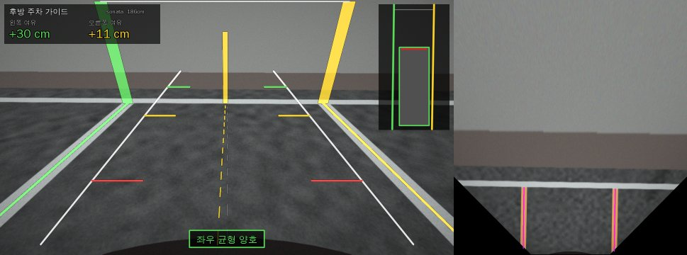
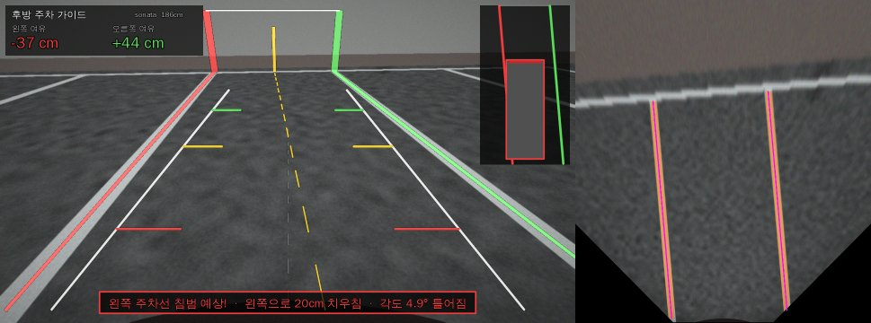
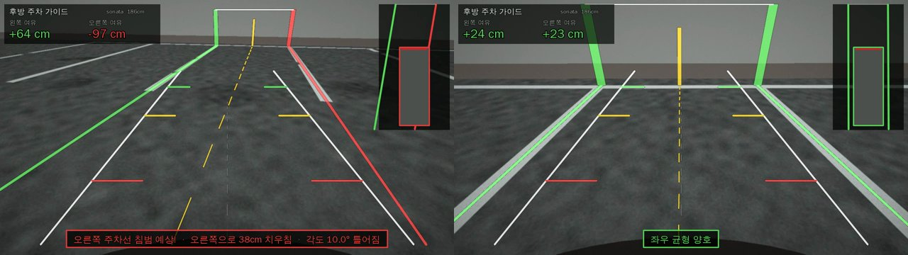

# 후방 주차 가이드 (Parking Guide) — 비전 프로토타입

공주시는 후진 주차를 돕기 위해 주차칸 끝 벽에 **수직 주차선**을 페인트로 칠해 두었다.
이 프로젝트는 벽에 일일이 칠하는 대신, 후진할 때 **후방카메라 화면에서 바닥 주차선을 인식해
가상의 수직 기준선을 그려 주고**, 차폭을 기준으로 **좌우 균형**(여유 거리, 치우침, 각도)을 알려 준다.

최종 목표는 현대자동차·기아의 **Pleos Playground**(Android Automotive 기반 차량 앱 플랫폼) 앱이다.
이 폴더는 그 핵심인 영상 처리 알고리즘을 Python + OpenCV로 먼저 검증하는 프로토타입이다.





## 화면 구성

| 요소 | 설명 |
|---|---|
| 가상 벽 수직선 | 인식한 좌우 주차선이 끝나는 지점(벽 쪽)에 세운 세로 기준선. 벽에 칠하던 선을 대신한다 |
| 바닥 주차선 강조 | 좌우 여유에 따라 초록(충분) / 노랑(15cm 미만) / 빨강(선 침범 예상) |
| 주차칸 중심선 | 노란 점선. 차 중심선(회색 점선)과 겹치면 중앙 정렬 상태 |
| 차폭 가이드 | 지금 그대로 후진했을 때 차 양옆이 지나갈 선. 1m / 2m / 3m 눈금 |
| HUD | 왼쪽·오른쪽 여유 거리(cm), 상태 문구, 위에서 본 미니맵 |

좌우 여유는 뒷범퍼 위치와 차 앞부분 위치 두 곳에서 계산하고 더 좁은 쪽을 보여 준다.
차가 비스듬하면 앞부분이 선을 먼저 넘기 때문이다.

## 처리 과정

1. **조감도 변환**: 카메라 설치 높이, 숙인 각도, 초점거리로 영상 → 지면 호모그래피를 만들고 위에서 본 영상(cm 단위)으로 펼친다.
2. **선 마스크**: 가로 방향 Top-hat으로 조명 변화를 없애고 Otsu로 밝은 페인트만 남긴다. 세로 방향 열림 연산으로 가로선(끝선)을 지운다.
3. **직선 피팅**: 연결 요소마다 행별 중심을 구해 `X = a + b·Y`로 피팅한다. 화면 경계에서 잘린 행은 제외한다. 닳아 끊긴 조각은 연장선 위에 있으면 합친다.
4. **주차칸 선택**: 간격이 200~340cm이고 거의 평행한 선 한 쌍 중, 차 중심에 가장 가까운 쌍을 고른다. 두 선의 기울기는 평행하도록 맞춘다.
5. **균형 판정**: 차폭·전장과 선 안쪽 가장자리 사이 거리로 여유, 치우침, 각도를 계산한다. 영상에서는 지수 이동 평균으로 흔들림을 줄인다.

합성 장면 기준 정확도: 치우침 오차 약 1cm, 각도 오차 약 0.1°. 단, 주차칸에 깊이 들어가 선이 1m 안쪽만 보이면 각도 오차가 1° 안팎으로 커진다.
속도: 1280×720 한 프레임 분석 약 25ms(개발 서버 CPU, Python).

## 실행

```bash
cd parking_guide
pip install -r requirements.txt

python demo.py scenes                 # 합성 장면 7개 → output/scenes/
python demo.py --debug scenes         # 조감도·마스크 패널을 옆에 붙여서
python demo.py video                  # 후진 주차 시뮬레이션 → output/reverse_parking.mp4
python demo.py --vehicle avante video # 차종 바꾸기 (또는 --vehicle 185x470)
python demo.py image my_rear.jpg --height 95 --pitch 28 --focal 600   # 실제 사진

python -m pytest -q                   # 테스트
```

## 폴더 구조

```
parking_guide/
  camera.py    카메라 모델, 지면 ↔ 영상 ↔ 조감도 변환
  synth.py     합성 후방카메라 영상 생성 (아스팔트, 주차선, 마모, 그림자, 벽)
  detector.py  주차선 검출, 주차칸 선택, 좌우 균형 계산, 프레임 평활화
  overlay.py   가상 벽 수직선, 차폭 가이드, HUD, 미니맵 그리기
  vehicles.py  현대·기아 차종별 전폭/전장 (참고값)
  text.py      한글 문구 그리기 (Pillow + 시스템 한글 폰트, 없으면 영어)
demo.py        장면 / 영상 / 실제 사진 데모
tests/         정확도, 경계 조건 테스트
```

## 한계와 다음 단계

- **실제 카메라 보정**: 지금은 왜곡 없는 핀홀 카메라를 가정한다. 실제 후방카메라는 광각(어안) 렌즈라 `cv2.fisheye` 왜곡 보정과 차량별 설치 높이·각도 보정(바닥 체커보드)이 필요하다.
- **실제 영상 검증**: 밤, 비, 빛 반사, 바닥 글씨·화살표, 옆 차 그림자 등을 실제 영상으로 확인해야 한다.
- **주차칸 깊숙이 들어간 경우**: 끝선(가로선) 방향을 함께 써서 각도를 보정할 수 있다.
- **Pleos 연동**: 2026-11 기준 공개된 Pleos Vehicle SDK에는 **카메라 영상 API가 없고**, 하드웨어에 직접 접근하지 말라는 정책이 있다. 쓸 수 있는 것은 `SteeringWheel`(조향각, 예상 궤적선용) 등이다. 기어(R단) 상태와 차폭 제원 API는 확인되지 않아, 차폭은 VIN → 차종 조회나 사용자 입력으로 채워야 한다. 카메라 접근은 Pleos 측 문의가 필요하다.
