# Pleos CarDex — 도로 위 차량을 카드로 모으는 차량 도감 (MVP)

현대차그룹 **Pleos Connect** 인포테인먼트 앱(Pleos Playground SDK / 에뮬레이터)입니다.
주행 중 마주친 차량을 **YOLOv8**로 인식하고, 사용자가 고른 정보(가격·마력 등)를 **AI 프롬프트**로 넣어
**카드(앞면: 차량 일러스트 / 뒷면: AI 요약)**를 만들어 **28종 도감**에 모읍니다. 모은 차량은 **쇼룸**에 전시하고,
희귀 차량을 만나러 **AI 추천 코스**로 새 지역을 달리며 지역 스탬프·지역 마스터·랭킹으로 경쟁합니다.

**핵심 루프**: 차량 인식 → 내 키워드로 AI 카드 → 도감 수집(일반·희귀·전설) → 쇼룸 자랑 → 희귀 차량을 찾아 새 지역으로 → 다시 수집

## 기획 메모 → 구현 대응

| 기획 | 구현 |
|---|---|
| 차량 인식: YOLOv8 (가볍고 빠름) | `backend/app/services/detector.py` — `yolov8n.pt`, COCO 차량 클래스, 영상은 트래킹으로 같은 차 중복 제거 |
| 인식 방법: 서라운드뷰 등 차량 내부 API 연계 예정 → 지금은 **영상 직접 입력** | 앱: `VideoFrameSource` 가 재생 중인 주행 영상의 프레임을 주기적으로 전송 / 서버: `POST /api/v1/recognize/video` 로 영상 통째 분석도 가능. 서라운드뷰 API 공개 시 `FrameSource` 만 교체 |
| 차종·마력 등 정보 조회 → LLM API 키 활용 | `identifier.py`(차종 식별) + `summarizer.py`(유저 키워드 동적 주입 요약), Claude API |
| 카드: 앞면 차량 이미지 / 뒷면 정보 요약 | `FlipCard.kt` — 탭하면 뒤집힘 |
| 주행 중 마주친 차량 도감 등록 + 시너지 점수 | `store.py`(최초 발견 위치 = Pleos FusedLocation) + `synergy.py` |
| 쇼룸(차고) 꾸미기 | `routers/showroom.py`·`services/decor.py` + `ShowroomStage.kt`·`ShowroomScreen.kt` — 대표 차량 전시 + 배경/바닥/조명/전시대/네온 간판/소품(드래그 배치) 꾸미기, 아이템은 여행으로 해금 |
| 명소 히든 스탬프 | `services/tour.py`·`landmarks.py` + `PleosVehicleContextProvider.watchLandmarks` — 한국관광공사 TourAPI 명소/축제에 Pleos 근접 알림 등록 → 반경 500m 진입 시 획득 (서버가 거리 재검증) |
| AI 드라이브 코스 추천 | `services/courses.py` + `TravelScreen.kt` + `PleosNavi.kt` — 미획득 지역·축제·명소 후보를 서버가 모으고 LLM 이 코스 선택 → Pleos NaviHelper 로 길안내 |
| 경쟁 ① 코스 완주 챌린지 | `services/challenge.py` — 추천 코스로 챌린지 시작 → 모든 장소(500m) 방문 시 완주 보너스 `30 + 예상점수/2` (24시간 제한) |
| 경쟁 ② 주간 랭킹 · 지역 마스터 | `services/competition.py` + `RankingScreen.kt` — 여행 점수 원장으로 이번 주 전국/지역 랭킹, 이번 달 시·도별 1위 = 지역 마스터(쇼룸에 🚩👑). 시연용 가상 경쟁자 `data/rivals.json` |
| 경쟁 ③ 축제 한정 코스 | 축제가 포함된 코스를 축제 기간 안에 완주하면 한정 배지 + 50점 (기간이 지나면 다시 못 얻음) |
| 지나간 지역 스탬프로 배경 꾸미기 | `services/regions.py`·`stamps.py` — Pleos FusedLocation 위치로 17개 시·도 스탬프 획득 → 쇼룸 배경 테마/스티커(최대 3개)로 사용 |

### 시너지 점수 규칙 (MVP 정의, `synergy.py` 상수로 튜닝)
- 기본: 희귀도 합 (common 10 / rare 30 / legendary 100)
- 재회: 같은 차량을 다시 마주칠 때 +2 (차량당 최대 10)
- 브랜드 컬렉터: 같은 브랜드 3종 이상 +50
- 그룹 트리오: 현대·기아·제네시스 모두 수집 +100
- 다양성: 차체 유형 3가지 이상 +30
- 대표차 공명: 쇼룸 대표 차량과 같은 브랜드 카드 1장당 +5

**여행 점수 (국내 여행·지역 방문 장려)**
- 지역 스탬프: 첫 방문 시 `travel_points` — 수도권 10 / 광역시·세종 20 / 도 30 / 강원·전남·제주 40 (지방·인구감소지역일수록 높게, 예시값)
- 단골 여행: 같은 지역 재방문(1시간 이상 간격) +5 (지역당 최대 15)
- 권역 완주: 수도권·충청권·호남권·영남권 내 모든 시·도 방문 시 +100
- 여행지 발견: 수도권 밖에서 처음 발견한 차량 1대당 +10
- 히든 스탬프: 명소 15 + 지역 가중치/2 (축제 +10) — 예: 부산 명소 25, 전남 명소 35
- 코스 완주: 30 + 코스 예상 점수/2 / 축제 한정 배지: +50

### 경쟁 규칙
- **속도·주행시간 경쟁은 하지 않습니다** (안전). 오직 방문·수집으로 얻은 여행 점수로만 순위를 매깁니다.
- 주간 랭킹: 이번 주(KST, 월~일) 여행 점수 합계 — 전국 / 지역별
- 지역 마스터: 이번 달 그 시·도에서 얻은 여행 점수 1위. 동점이면 기존 1위 유지 → 넘어서야 빼앗음 (재방문 유도)
- MVP 는 단일 사용자 + 가상 경쟁자 6명. 실제 서비스는 계정·서버 DB 기반 원장으로 교체 필요

## 시연 영상

[`docs/demo/cardex_demo.mp4`](docs/demo/cardex_demo.mp4) (약 61초, 1280×720, 자막 포함 · 음성 없음)

타이틀 → 첫 실행 안내 → **도감 홈(28종·실루엣)** → **YOLOv8 실제 인식 → 내가 고른 정보 → AI 요약 → 카드 앞면 일러스트/뒷면 요약** → **전설 카드 획득** → 도감 6/28·세트 보너스 → 쇼룸 전시·꾸미기 → (희귀 차는 새 지역에서) AI 코스·주행 모드·지역 마스터 → 랭킹 → 사용 기술

> 실제 앱의 화면 코드를 샘플 데이터로 렌더링하고 버튼은 실제로 클릭해 진행한 **UI 시연 영상**입니다 (에뮬레이터 녹화 아님).
> 다시 만들기: `./scripts/make_demo_video.sh` (JDK 17 · Android SDK · ffmpeg 필요). 장면·자막은 `android/app/src/test/.../DemoVideoFramesTest.kt` 에서 수정.

## 차량 카드 수집 (메인)

| 도감 홈 (첫 화면) | 미발견 칸 = 실루엣 |
|---|---|
| 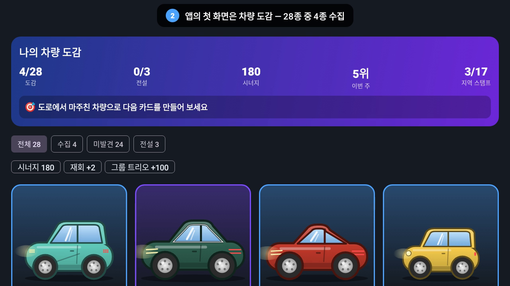 | 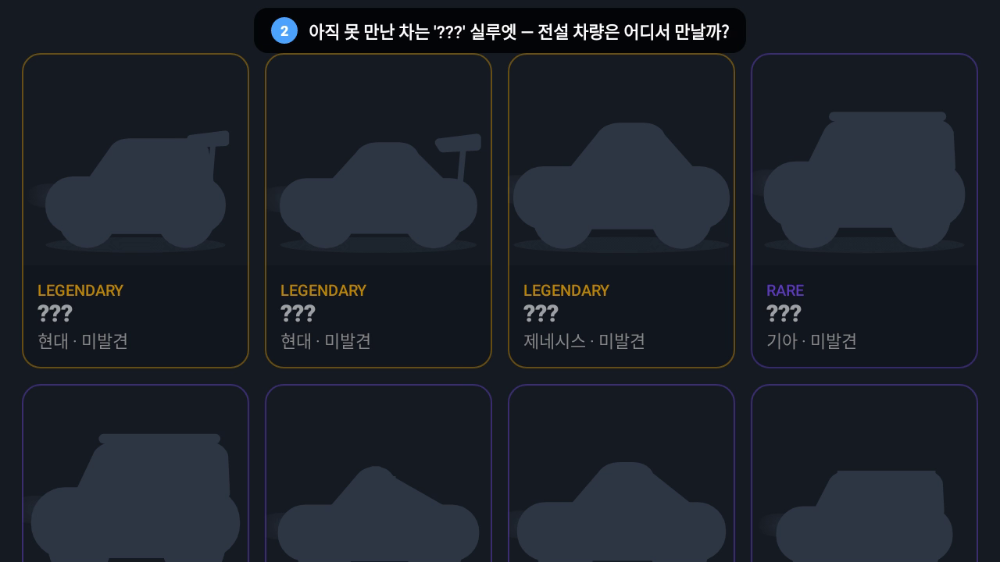 |

- **도감 28종** (현대·기아·제네시스 — 일반 15 · 희귀 10 · 전설 3: 아이오닉 5 N · 아반떼 N · 제네시스 G90). 못 만난 차량은 '???' 실루엣
- 필터: 전체 / 수집 / 미발견 / 전설, 상단 요약: 도감 n/28 · 전설 n/3 · 시너지 · 주간 순위 + **다음 목표**(예: "현대 차량 1종 더 모으면 '현대 컬렉터' +50")
- 탭 순서: **도감(시작) → 수집 → 쇼룸 → 여행 → 랭킹 → 설정**

수집 방법(차량 영상 입력 경로)은 미정이며, 어떤 입력이든 다음 흐름으로 카드가 됩니다.

**YOLOv8 차량 인식 → 사용자가 고른 정보(키워드) → AI 프롬프트에 주입해 요약 → 카드 (앞면: 차량 일러스트 / 뒷면: 요약) → 도감 등록**

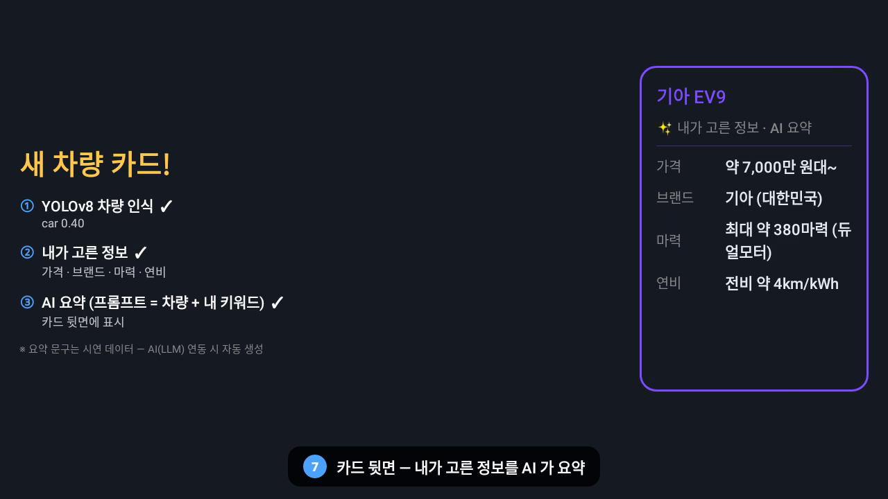

### 실제 AI 요약 만들기 (Claude API 키 필요)

```bash
cd backend && pip install -r requirements.txt
echo "ANTHROPIC_API_KEY=sk-ant-..." >> .env     # 키는 채팅·커밋에 올리지 말 것
python ../scripts/generate_ai_cards.py          # 기본 키워드: 가격 브랜드 마력 연비 (다른 키워드: 인자로)
../scripts/make_demo_video.sh                    # docs/demo/ai_cards.json 이 있으면 영상 카드 뒷면에 실제 AI 요약 사용
```

## 차량 인식 (베타) 검증 현황

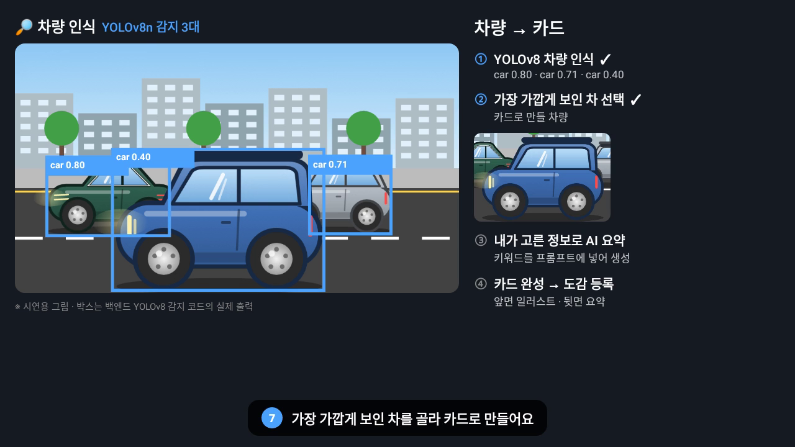

| 단계 | 상태 |
|---|---|
| ① YOLOv8 차량 감지 | ✅ 백엔드 API(`/recognize`, `/recognize/video`)로 실제 실행 확인 — COCO 샘플 사진에서 버스 0.80~0.94·승용차 0.64 감지, 사람만 있는 사진은 '차량 없음', 4초 패닝 영상에서 같은 차를 1대로 추적. 위 장면(직접 그린 도로)에서 car 0.80 / 0.71 / 0.40 |
| ② 가장 가까운 차 선택·잘라내기 | ✅ 확인 |
| ③ 차종 판별·키워드 요약 (Claude) | ⏳ API 키 연동 후 확인 필요 (지금은 mock) |
| ④ 도감 등록 (신규/재발견) | ✅ 백엔드 테스트로 확인 |

- YOLO 객체 추적(`model.track`)에는 `lap` 패키지가 필요해 `requirements-vision.txt` 에 추가. 없으면 IoU 기반 대체 추적으로 자동 전환
- 감지 장면 재생성: `python scripts/detect_demo_scene.py <이미지> <출력.json>` (백엔드의 실제 감지 코드 사용)

## 화면

| 여행 홈 (한눈에 보기 + 챌린지 + 히든 스탬프) | 주행 모드 (화면 잠금 + 음성 안내) |
|---|---|
| 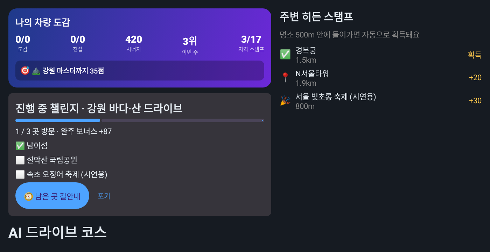 | 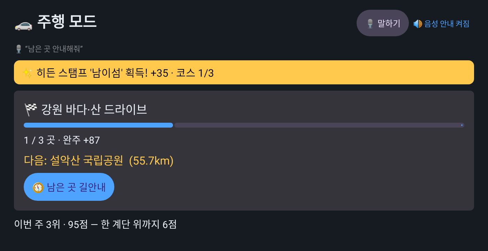 |
| **랭킹 · 지역 마스터** | **성취 축하** |
| 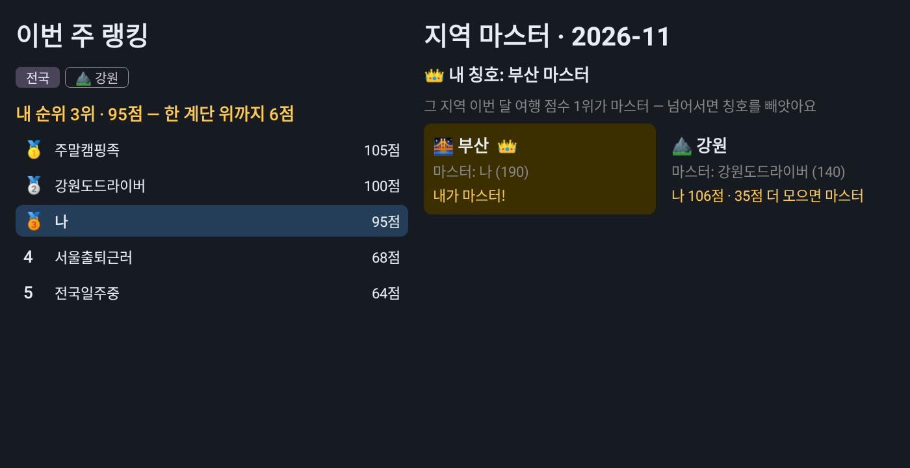 | 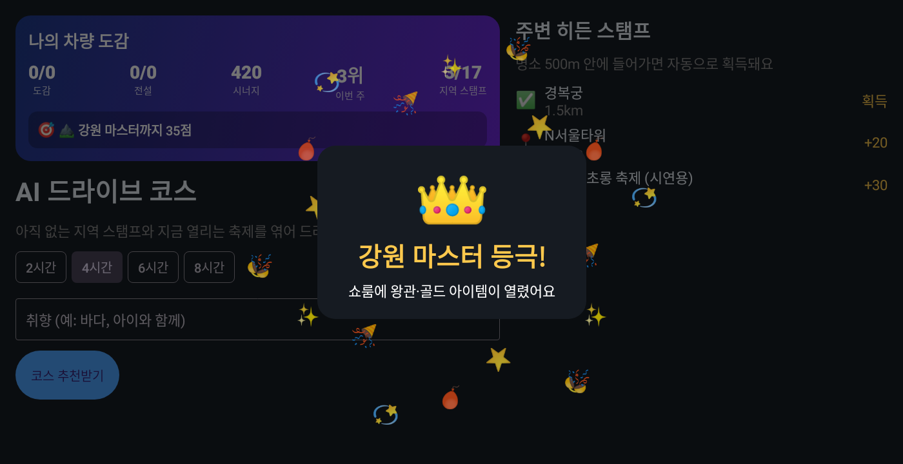 |
| **첫 실행 안내 (권한 사용 목적 설명)** | **AI 코스 추천** |
| 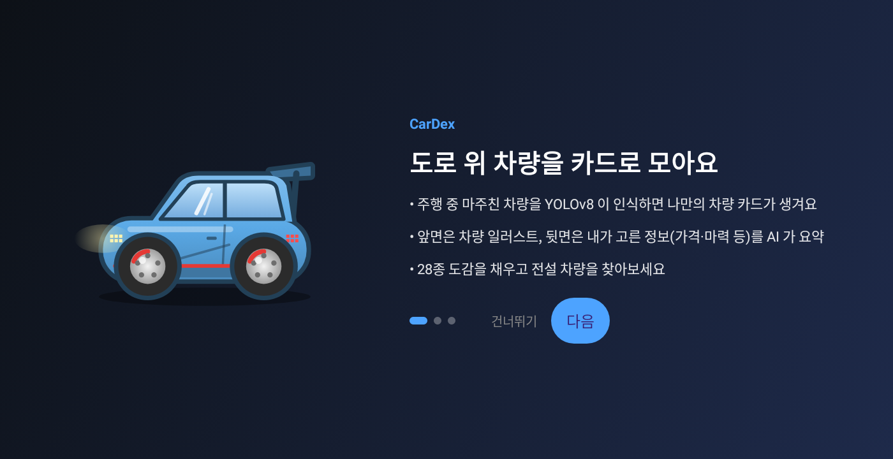 | 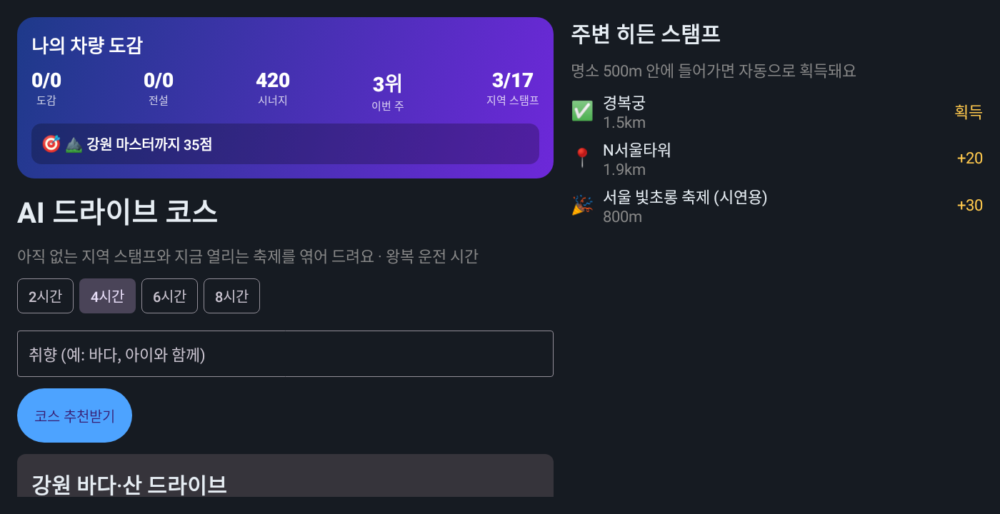 |

- 첫 실행: 안내 3장(서비스 소개 · 쇼룸 · 안전/위치 사용 목적) → 마지막에 Pleos 권한 요청
- 여행 탭 상단 '나의 여행': 시너지·주간 순위·스탬프·쇼룸 아이템 + **다음 목표 한 줄**(진행 중 코스 → 가장 가까운 지역 마스터 → 다음 순위)
- 코스 완주 · 축제 배지 · 지역 마스터 등극 시 축하 연출 (주행 중엔 음성만, 화면 연출은 정차 후)
- 서버 연결이 끊기면 하단 배너 + 다시 시도, 오류는 사용자 문구로 표시
- 스크린샷 재생성: `cd android && ./gradlew testDebugUnitTest --tests '*ScreenshotTest*'` → `app/build/screenshots/`

## 쇼룸 디자인

차고 꾸미기라는 방식만 참고한 **자체 디자인**입니다 (특정 게임의 그래픽·명칭·에셋 미사용). 모든 그래픽은 Compose Canvas 로 직접 그립니다.

| 부산 마스터 (체커 바닥 · 골드 포디움 · 골드 조명) | 강원 (네온 그리드 · 네온 링 · 오로라 조명) |
|---|---|
| 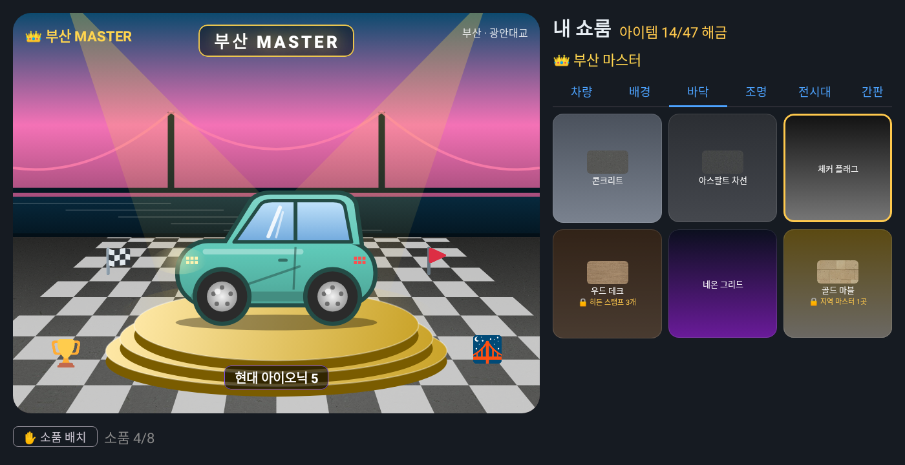 | 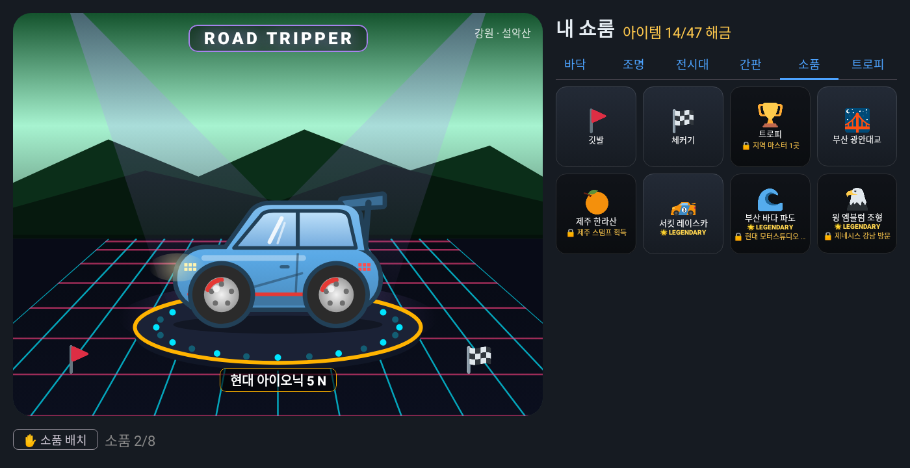 |

| 슬롯 | 아이템 (해금 조건 예시) |
|---|---|
| 배경 | 기본 차고 + 지역 스탬프 17곳의 풍경 (도시·바다·산·한옥·섬·들판·호수·대교·성곽) |
| 바닥 | 콘크리트 / 아스팔트 차선(스탬프 2) / 체커(코스 완주 1) / 우드(히든 3) / 네온 그리드(시너지 300) / 골드 마블(마스터 1) |
| 조명 | 화이트 / 선셋(스탬프 3) / 오션(히든 1) / 오로라(축제 배지 1) / 챔피언 골드(마스터 1) |
| 전시대 | 기본 턴테이블 / 네온 링(완주 1) / 골드 포디움(마스터 1) — 회전 애니메이션 |
| 네온 간판 | MY GARAGE / ROAD TRIPPER(스탬프 5) / CAR COLLECTOR(시너지 200) / `OO MASTER`(마스터) |
| 소품 (최대 8, 드래그·크기 조절) | 깃발·풍선·체커기·카메라·지도·벚꽃·불꽃·메달·트로피·왕관·별 + 지역 랜드마크 17종 |

- 전시대 위 차량은 **둥글둥글한 카툰 일러스트**. 시연 차종 6종은 실제 차의 알아볼 수 있는 특징(비율·램프 모양·루프랙·윙 등)만 살렸고 **로고·엠블럼은 그리지 않음**. 그 외 차량은 차체 유형 + 희귀도 색 기본형. 실제 도감 사진은 벽의 폴라로이드 액자

  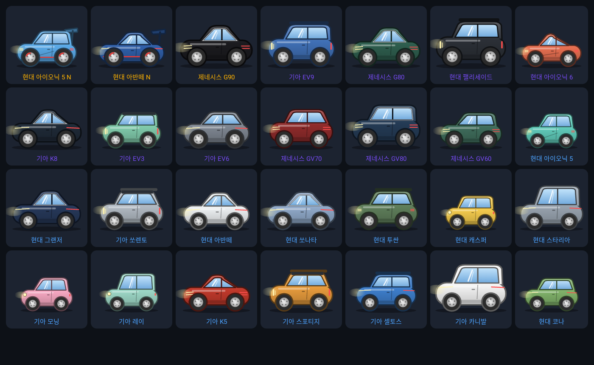

  | 차종 | 일러스트 특징 |
  |---|---|
  | 현대 아이오닉 5 | 짧은 해치백 비율, 픽셀 램프, 사선 캐릭터 라인 |
  | 기아 EV9 | 박스형 대형 SUV, 세로 램프, 루프랙 |
  | 제네시스 G80 | 길고 낮은 세단, 두 줄 램프, 크롬 창틀 |
  | 현대 그랜저 | 세단, 앞을 가로지르는 일자 LED·일자 테일램프 |
  | 기아 쏘렌토 | SUV, 세로 램프, 투톤 지붕, 루프랙 |
  | 현대 아이오닉 5 N (전설) | 낮은 차체, 리어 윙, 빨간 포인트 라인·캘리퍼, 큰 휠 |
| 그 외 22종 | 아반떼(N)·쏘나타·투싼·팰리세이드·캐스퍼·아이오닉 6·스타리아·코나·모닝·레이·K5·K8·스포티지·셀토스·카니발·EV3·EV6·G90·GV70·GV80·GV60 — 차체 비율·램프·색으로 구분 |
- 마스터 칭호를 잃으면 마스터 전용 아이템은 자동으로 기본 아이템으로 돌아감 → 칭호를 지키러 다시 방문

## Pleos Playground 에서 쓰는 것

| 항목 | 내용 |
|---|---|
| SDK 저장소 | `https://nexus-playground.pleos.ai/repository/maven-releases/` (공식 샘플과 동일) |
| FusedLocation SDK | `ai.pleos.playground:FusedLocation:1.1.3`, 권한 `pleos.car.permission.FUSED_LOCATION` — 지역 스탬프 획득 + 도감의 '발견 장소' |
| NaviHelper SDK | `ai.pleos.playground:NaviHelper:3.0.5`, 권한 `NAVI_ROUTE`·`NAVI_ROUTE_SEARCH` — AI 코스 길안내 (목적지 + 경유지 2곳) |
| Vehicle SDK | `ai.pleos.playground:Vehicle:2.3.2`, 권한 `CAR_DRIVE` — 기어(P단) 상태 (보조: SDK 에서 기어 API 가 deprecated 되어 아래 표준 API 를 우선 사용) |
| Android Automotive 표준 | `CarUxRestrictionsManager` — 차량이 알려주는 '주행 중 UX 제한' 으로 **주행 중 화면 잠금** (1순위) |
| TextToSpeech SDK | `ai.pleos.playground:TextToSpeech:3.3.1` (ON_DEVICE), 권한 `TTS_SERVICE` — 스탬프·코스 알림 **음성 안내** (실패 시 안드로이드 기본 TTS) |
| 서라운드뷰/카메라 | 공개 API 미확인 → 영상 직접 입력으로 대체 |

> **빌드 확인**: Pleos SDK(FusedLocation 1.1.3, NaviHelper 3.0.5, Vehicle 2.3.2, TextToSpeech 3.3.1)를 실제로 받아
> `./gradlew assembleDebug` 컴파일과 `./gradlew lintDebug`(오류 0건)까지 통과했습니다. 에뮬레이터/실차에서의 동작 확인은 아직입니다.

## 운전자 안전 설계
- **주행 모드**: 주행 중(① Android Automotive 표준 주행 중 UX 제한 → ② Pleos 기어 ≠ P → ③ 위치 기반 속도 5초 평균 8km/h 이상, 순서대로 사용)에는 모든 조작 화면을 잠그고,
  큰 글씨의 정보(챌린지 진행률·다음 장소·가까운 히든 스탬프·랭킹)와 **"남은 곳 길안내" 버튼 하나**만 보여줍니다. 정차(P단)하면 전체 기능이 열립니다.
- **음성 안내**: 스탬프 획득·코스 진행·완주 알림을 Pleos TTS 로 읽어줘 화면을 볼 필요가 없습니다 (주행 모드에서 끄기 가능).
- **속도 경쟁 없음**: 랭킹·마스터는 방문·수집 점수로만 계산합니다.
- **위치 정보 최소화**: 서버에는 지역 판정·명소 반경 확인에 필요한 좌표만 보내고, 이동 경로는 저장하지 않습니다(도감의 '최초 발견 위치'만 저장).
- 시연용: 디버그 빌드의 여행 탭에 `🚗 주행 모드 시연` 버튼 (에뮬레이터에서 기어를 바꾸기 어려울 때)

> **API 키 관련 메모**: 공식 FusedLocation 샘플 기준, 차량 내 SDK(FusedLocation/Vehicle)는 별도 API 키 없이
> Maven 의존성 + 권한으로 동작합니다. Playground 에서 발급하는 *Vehicle Data API* 키는 내 차량의 커넥티드
> 데이터를 클라우드 REST 로 받는 용도(개인 발급은 현재 유럽 한정)라 주변 차량 인식과는 무관합니다.
> 차량 정보 요약에 필요한 키는 **LLM API 키**(`ANTHROPIC_API_KEY`)입니다.

## 구조

```
pleos_car_dex/
├── backend/                         FastAPI
│   ├── app/
│   │   ├── routers/                 recognize(이미지·영상) / collection(+시너지) / showroom / stamps / preferences
│   │   ├── services/
│   │   │   ├── detector.py          YOLOv8 감지·크롭·영상 트래킹
│   │   │   ├── identifier.py        차종 식별 (Claude 비전 / mock)
│   │   │   ├── summarizer.py        키워드 기반 요약 (Claude / mock)
│   │   │   ├── synergy.py           시너지 점수
│   │   │   ├── pipeline.py          전체 흐름 (+ 방금 본 차량은 LLM 재호출 생략)
│   │   │   ├── regions.py / stamps.py  위치 → 지역 스탬프 판정·스탬프북
│   │   │   ├── store.py             도감·설정·쇼룸·스탬프 JSON 저장소
│   │   │   ├── catalog.py / llm.py
│   │   └── data/                vehicle_catalog.json(시연 차종 6종), regions.json(17개 시·도 스탬프·배경 테마)
│   └── tests/test_api.py            mock 모드 E2E (이미지·영상·시너지·스탬프·쇼룸)
├── android/                         Pleos Connect 앱 (Kotlin/Compose)
│   └── app/src/main/
│       ├── assets/demo_video/       ← 시연 주행 영상 demo_drive.mp4
│       ├── assets/demo_frames/      ← (대체) 시연 이미지
│       └── java/com/pleos/cardex/
│           ├── pleos/VehicleContext.kt  Pleos FusedLocation 위치·근접 알림 (+목업 대체)
│           ├── pleos/GearMonitor.kt     Pleos Vehicle SDK 기어 → 주행 모드
│           ├── pleos/VoiceGuide.kt      Pleos TTS 음성 안내
│           ├── pleos/PleosNavi.kt       Pleos NaviHelper 길안내
│           ├── pleos/FrameSource.kt     영상 프레임 입력 (서라운드뷰 연계 지점)
│           ├── data/                    Retrofit API
│           └── ui/                      여행(코스·챌린지·히든) / 랭킹 / 쇼룸 / 도감 / 인식(베타) / 키워드 / 주행 모드
└── scripts/demo_request.sh
```

## 빠른 시작

### 백엔드
```bash
cd backend
python -m venv .venv && source .venv/bin/activate
pip install -r requirements-vision.txt     # YOLOv8 포함 (mock 만 쓸 거면 requirements.txt)
cp .env.example .env                       # ANTHROPIC_API_KEY(LLM), TOUR_API_KEY(공공데이터포털) 입력 — 비우면 mock
uvicorn app.main:app --host 0.0.0.0 --port 8000
# 영상 통째 테스트
curl -F "video=@drive.mp4" http://localhost:8000/api/v1/recognize/video
```
완전 오프라인 시연: `DETECTOR_MODE=mock IDENTIFIER_MODE=mock USE_MOCK_LLM=true` (파일명으로 차종 결정).
**시연 도구** (`DEMO_MODE=true`): 앱 **설정 탭 → 시연 데이터 채우기**(차량 4 · 지역 스탬프 3 · 히든 2) / **전체 초기화**(영상 재촬영용) / 주행 모드 시연. API: `POST /api/v1/demo/seed`, `POST /api/v1/demo/reset`
테스트: `python -m pytest -q`

**TourAPI 키 발급**: 공공데이터포털(data.go.kr)에서 '한국관광공사_국문 관광정보 서비스_GW' 활용신청 → 일반 인증키(Decoding)를 `TOUR_API_KEY` 에 입력.
키가 없으면 `app/data/mock_attractions.json`(전국 명소 19곳 + 시연용 축제 5개)으로 동작합니다.

### Pleos 앱
1. Android Studio 로 `android/` 열기 (또는 `./gradlew assembleDebug`) → Pleos Connect 에뮬레이터 실행
2. `assets/demo_video/demo_drive.mp4` 에 주행 영상 넣기
3. 실행 → Pleos 권한(위치·기어·내비) 허용 (지원 안 되는 환경이면 자동으로 목업 위치)
   앱은 **여행 탭**에서 시작합니다. 차량 인식은 `인식(베타)` 탭 — 차량 영상 API 공개 후 확장 예정
4. 스캔 탭: 영상 재생 중 `자동 스캔` → 차량 카드 등장, 탭하면 뒤집혀 키워드 요약
5. 도감 탭: 시너지 점수 확인, `쇼룸에 전시` 로 대표 차량 지정
6. 쇼룸 탭: 대표 차량 무대 + 획득한 지역 스탬프로 배경/스티커 꾸미기, 스탬프북 확인
   (에뮬레이터에서 `adb emu geo fix 129.07 35.17` 로 부산 이동 → 부산 스탬프 획득)
7. 여행 탭: 왕복 시간·취향 선택 → `코스 추천받기` → `🏁 챌린지 시작 + Pleos 길안내` → 장소 방문할 때마다 진행률, 완주 시 보너스/한정 배지
   랭킹 탭: 이번 주 순위, 지역 마스터 현황 (몇 점 더 모으면 마스터인지)
   우측 '주변 히든 스탬프'에서 명소 거리 확인 (`adb emu geo fix 129.1604 35.1587` → 해운대 히든 스탬프)
8. 키워드 탭: 항목 변경 → 다음 인식부터 카드 뒷면 변경

에뮬레이터 → 호스트 백엔드 주소는 `http://10.0.2.2:8000/` (기본값). 다른 주소: `./gradlew assembleDebug -PapiBaseUrl=http://192.168.0.10:8000/`
(디버그 빌드는 LAN HTTP 허용, 릴리스 빌드는 에뮬레이터 주소만 허용 — 배포 시 HTTPS 필요)
에뮬레이터 위치 테스트: `adb emu geo fix 127.0276 37.4979` (경도 먼저).

## API

| Method | Path | 설명 |
|---|---|---|
| POST | `/api/v1/recognize` | 프레임 1장 + `lat`,`lon`,`keywords` → 카드 |
| POST | `/api/v1/recognize/video` | 주행 영상 → 차량별 카드 (최대 `VIDEO_MAX_VEHICLES`) |
| GET | `/api/v1/collection` | 도감 + 시너지 점수 |
| DELETE | `/api/v1/collection/{id}` | 도감 삭제 |
| GET / PUT | `/api/v1/showroom` | 쇼룸 조회 / `{card_id, background_region_id, floor_id, light_id, pedestal_id, sign_id, props[{item_id,x,y,scale}]}` 변경 (해금된 것만) |
| GET | `/api/v1/showroom/items` | 꾸미기 아이템 전체 + 해금 여부·조건 |
| GET | `/api/v1/stamps` | 스탬프북 (17개 시·도, 미획득 포함) |
| POST | `/api/v1/stamps/visit` | `{lat, lon}` 방문 보고 → 새 지역이면 스탬프 획득 (인식 요청에 위치가 있어도 자동 기록) |
| GET | `/api/v1/landmarks/nearby?lat&lon&radius_m` | 주변 TourAPI 명소·진행 중 축제 (획득 여부·점수) |
| POST | `/api/v1/landmarks/{content_id}/visit` | `{lat, lon}` 근접 진입 보고 → 반경 검증 후 히든 스탬프 |
| POST | `/api/v1/courses/recommend` | `{lat, lon, max_hours, date?, note?}` → AI 드라이브 코스 (이동 시간·예상 점수는 서버 계산) |
| POST / GET / DELETE | `/api/v1/challenge` | 코스 챌린지 시작(`DriveCourse` 그대로) / 현재 상태 / 포기 |
| GET | `/api/v1/rankings/weekly?region_id=` | 이번 주 랭킹 (내 순위, 윗 순위까지 남은 점수) |
| GET | `/api/v1/rankings/masters` | 이번 달 시·도별 지역 마스터, 내 칭호 |
| GET | `/api/v1/home` | 여행 탭 요약 (점수·순위·스탬프·다음 목표) |
| POST | `/api/v1/demo/seed` · `/api/v1/demo/reset` | 시연 데이터 채우기 / 초기화 (`DEMO_MODE=true` 일 때만) |
| GET / PUT | `/api/v1/preferences` | 유저 키워드(최대 8개) |

## LLM 설정 메모
- `claude-opus-5-5`, 구조화 출력으로 카드 형식 보장, 응답성을 위해 `LLM_EFFORT=low`
- 안전 필터 거절 시 서버 측 자동 재시도(`fallbacks="default"`), 최종 실패 시 mock 요약
- 같은 차량을 2분 안에 다시 보면 저장된 카드 재사용 (영상 연속 인식 비용 절감)
- 카탈로그 수치는 예시값 — 시연 전 검수 필요
- 코스 추천: LLM 은 서버가 모은 후보 ID 중에서만 고르게 하고(없는 장소 지어내기 방지), 이동 시간·점수는 서버가 계산. 희망 시간을 넘으면 경유지를 자동으로 줄임. LLM 이 없으면 규칙 기반 추천
- 지역 판정은 시·도 중심좌표 최근접(반경 60km) 근사 — 경계 부근은 부정확할 수 있음 (역지오코딩으로 교체 가능)
