# Pleos CarDex — 도로 위 차량을 카드로 모으는 차량 도감 (MVP)

현대차그룹 **Pleos Connect** 인포테인먼트 앱(Pleos Playground SDK / 에뮬레이터)입니다.
주행 중 마주친 차량을 **YOLOv8**로 인식해 차종을 알아내고, **차량 정보 목록**에서 사용자가 고른 항목(가격·마력 등)을 꺼내
**카드(앞면: 차량 일러스트 / 뒷면: 내가 고른 정보)**로 만들어 **28종 도감**에 모읍니다. 모은 차량은 **쇼룸**에 전시하고,
희귀 차량을 만나러 **AI 추천 코스**로 새 지역을 달리며 지역 스탬프·지역 마스터·랭킹으로 경쟁합니다.

**핵심 루프**: 차량 인식 → 내가 고른 정보로 카드 → 도감 수집(일반·희귀·전설) → 쇼룸 자랑 → 희귀 차량을 찾아 새 지역으로 → 다시 수집

## 메인 화면

| 시작 화면 (그림 한 장) | 메인: 내 쇼룸 + 내비 검색·추천 | ☰ 메뉴 |
|---|---|---|
| 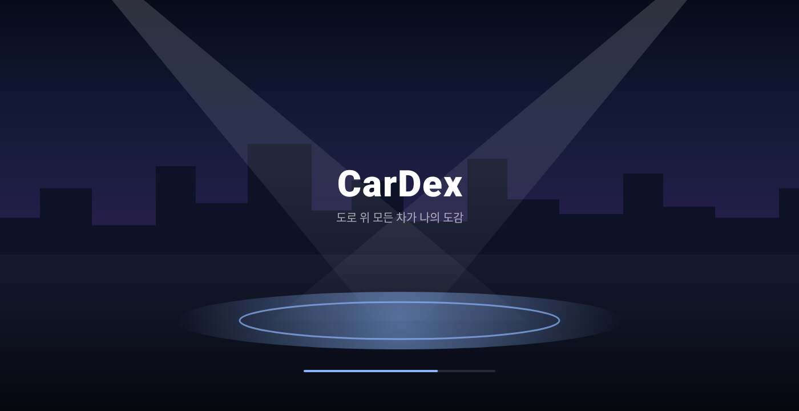 | 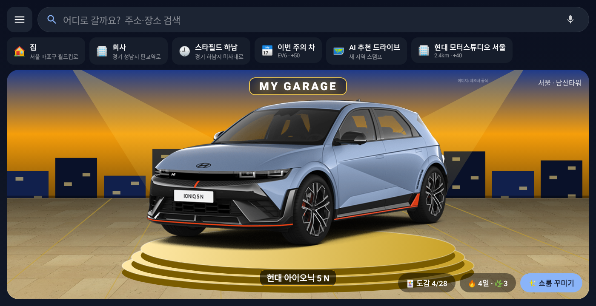 | 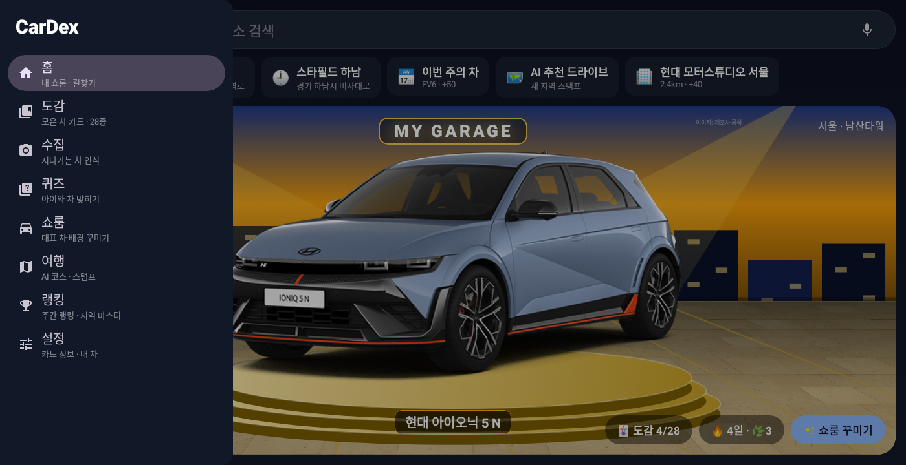 |

- **시작 화면**: 밤의 쇼룸 그림 + 로고만 (시스템 시작 화면도 같은 밤하늘 색이라 흰 화면 번쩍임 없음). 최소 1.2초, 첫 데이터가 오면 최대 2.5초 안에 넘어감
- **메인**: 가운데 내 대표 차량(공식 이미지, 턴테이블 회전)이 있는 쇼룸. 위쪽 **"어디로 갈까요?" 검색창** → Pleos 내비 장소 검색(`NavigationScreenRequest.SearchPlace`)을 검색어와 함께 열기, 🎤 음성
- **추천 줄**: Pleos 내비의 집·회사·즐겨찾기·최근 목적지(`getBookmarkInfo` / `getRecentDestinationInfo`, 탭하면 바로 길안내) + 진행 중 코스 · 이번 주의 차 · AI 추천 드라이브 · 가까운 브랜드 스팟/명소
- **☰ 메뉴**: 도감 · 수집 · 퀴즈 · 쇼룸 꾸미기 · 여행 · 랭킹 · 설정 (각 화면 상단에 ☰ · 제목 · 🏠)

## 왜 이 앱인가 (기획서용 가치 제안)

**한 줄**: "도로 위 모든 차가 수집 대상이 되는 순간, 운전이 여행이 되고 차는 브랜드 경험이 된다."

| 관점 | 써야 하는 이유 |
|---|---|
| **운전자 (차 사용자)** | ① 매일 같은 출퇴근길도 **이번 주의 차** 미션·연속 출석으로 작은 재미 ② **내 차**를 등록하면 만나는 차마다 "가격 +1,200만 원 · 마력 +50" 처럼 **내 차 기준 비교** ③ 주차하면 10초짜리 **오늘의 드라이브 리포트**(Pleos Odometer 거리·시간 + 모은 카드·스탬프) ④ 주말엔 희귀 차·스탬프를 찾아 **AI 코스**로 국내 여행 |
| **가족 (뒷좌석 아이)** | 지나가는 차의 종류·색깔 맞히기 퀴즈 → 별 → **쇼룸 스티커**. 장거리 운전 중 "언제 도착해?" 대신 함께 하는 놀이 (주행 중엔 음성으로만) |
| **현대차그룹 (임원 관점)** | ① **라인업 노출**: 28종 도감·이번 주의 차가 매일 다른 모델에 시선을 모음 (전설 = N·제네시스 플래그십) ② **오프라인 전환**: 브랜드 체험 스팟(모터스튜디오·기아 360·제네시스·HMG 드라이빙 센터) 방문 = 특별 스탬프 + **전설 쇼룸 아이템** → 시승·전시 방문 동기 ③ **차량 데이터 기반 리텐션**: Vehicle/Location SDK 를 쓴 '차 안에서만 되는' 경험 → Pleos 생태계 체류 시간 ④ **내수·지역 관광**: 지방일수록 높은 여행 점수, TourAPI 명소·축제 연계 |
| **환경** | 출석이 운전을 부르지 않도록 **차가 쉰 날(주행 기록 없는 날)도 연속으로 인정**하고 잎 🌿·점수·친환경 소품(🌱 🚲 숲빛 조명 🌳 GREEN GARAGE 🌍)으로 보상 |
| **안전** | 속도·주행시간 경쟁 없음, 주행 중 화면 잠금 + 음성만, 운전 습관 평가 안 함 (리포트는 '모은 것'만) |

**참신한 점**
1. 차량 인식을 **'도감 수집'** 게임 메커니즘으로 — 차를 '보는' 행위 자체가 콘텐츠 (포켓몬식 수집 × 자동차)
2. 카드 뒷면을 **사용자가 고른 정보**로 구성 + **내 차와 비교** → 같은 차라도 사람마다 다른 카드
3. 도감 → 쇼룸 → 여행 → 브랜드 공간으로 이어지는 **온·오프라인 루프**: 수집 욕구가 실제 이동(국내 여행)과 브랜드 방문으로 연결
4. 주차 시점(P단)을 **'하루를 돌아보는 순간'**으로 디자인 — 차량 신호를 UX 트리거로 사용

### 5회 개선 반영 (임원·사용자 관점)

| 회차 | 개선 | 사용자 가치 | 현대차 가치 |
|---|---|---|---|
| 1 | **내 차 등록 + 쌍둥이 차 + 내 차와 비교** | 모든 카드가 '내 차 기준'으로 의미가 생김 | 오너 정체성 강화, 상위 트림·모델 자연스런 비교 노출 |
| 2 | **이번 주의 차 미션 + 연속 기록** — 일주일 안에 평소 다니는 길에서 찾으면 됨 (일반 +30 / 희귀 +50), **격주 전기차 주간** | 매일 찾으러 나갈 필요 없음 | 주마다 모든 사용자가 같은 모델에 주목 → 라인업·전동화 홍보 |
| 2+ | **🌿 차 쉬는 날 (그린 데이)** — 운전 안 한 날도 연속 유지 + 잎 1장 +10점 + 친환경 쇼룸 아이템 | 매일 운전하라는 압박 없음, 안 타도 보상 | 환경 책임 메시지 (ESG), '꼭 필요할 때 타는' 건강한 사용 |
| 3 | **브랜드 체험 스팟** (특별 스탬프 +40, 전설 아이템, 코스 후보 포함) | 희귀 보상 · 갈 곳 추천 | 모터스튜디오·기아 360·제네시스 방문 유도 (오프라인 전환) |
| 4 | **주차 시 주행 리포트** (Pleos Odometer) | 드라이브를 한 장으로 돌아봄 + 음성 요약 | Vehicle SDK 기반 '차 안에서만 되는' 경험 |
| 5 | **퀴즈 별 → 쇼룸 스티커** | 아이 보상이 쇼룸 꾸미기로 이어짐 (랭킹 점수와 분리) | 가족 단위 사용 → 차량 앱의 일상화 |
| 6 | **친환경 배지 + 전동화 컬렉터** (카드 앞면 ⚡ EV / 🌿 친환경 트림, 전기차 3종 +50) | 수집하며 자연스럽게 EV 라인업을 알게 됨 | 전기차 캐즘(수요 정체) 국면에서 EV 관심 환기 |
| 7 | **🌿 저탄소 코스** (도달 거리 절반·가까운 곳 위주, 왕복 km·CO₂ 추정 표시, 전기차 오너는 주행 배출 0) + **주행 리포트 친환경 제안** (3km 미만은 걷기·자전거, 하루 3번째 운전은 볼일 묶기) | 같은 재미를 더 짧은 이동으로 | 탄소중립·ESG 메시지, 책임 있는 차량 앱 |

| 이번 주의 차 + 연속 기록 + 차 쉬는 날 | 브랜드 스팟 전설 아이템 | 주차 후 주행 리포트 |
|---|---|---|
| 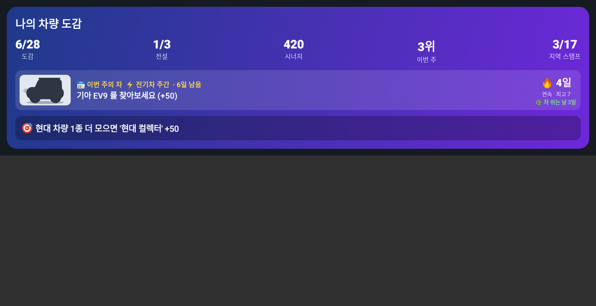 | 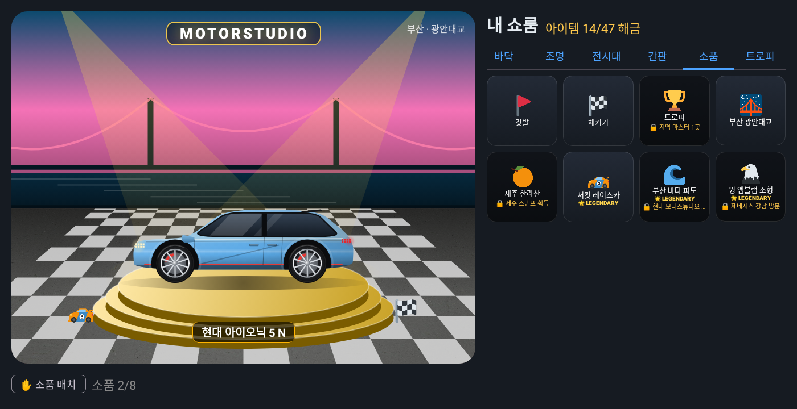 | 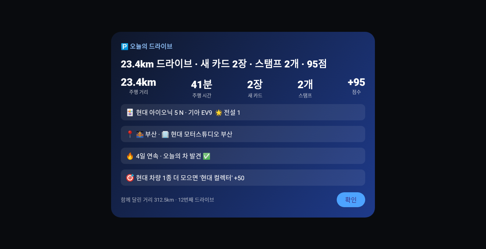 |

| 친환경 배지 (카드 앞면) | 저탄소 코스 선택 |  |
|---|---|---|
| 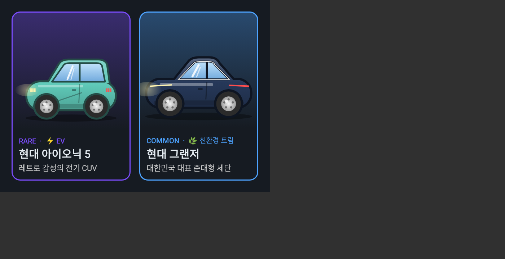 | 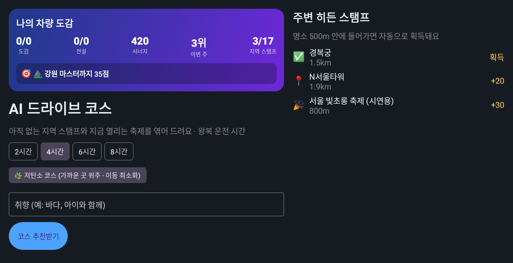 |  |

> CO₂ 는 승용차 평균 수준 예시값(0.14kg/km)으로 계산한 추정치입니다. 내 차 연비·연료 기준 계산은 추후 과제입니다.
> 브랜드 스팟 좌표는 대략값(시연용)입니다. 출시 전 공식 주소로 검증하세요 (`backend/app/data/brand_spots.json`).

## 기획 메모 → 구현 대응

| 기획 | 구현 |
|---|---|
| 차량 인식: YOLOv8 (가볍고 빠름) | `backend/app/services/detector.py` — `yolov8n.pt`, COCO 차량 클래스, 영상은 트래킹으로 같은 차 중복 제거 |
| 인식 방법: 서라운드뷰 등 차량 내부 API 연계 예정 → 지금은 **영상 직접 입력** | 앱: `VideoFrameSource` 가 재생 중인 주행 영상의 프레임을 주기적으로 전송 / 서버: `POST /api/v1/recognize/video` 로 영상 통째 분석도 가능. 서라운드뷰 API 공개 시 `FrameSource` 만 교체 |
| 차종·마력 등 정보 조회 | `identifier.py`(차종 판별: 28종 목록 중에서만 고름) + `summarizer.py`(**차량 정보 목록에서 고른 항목 조회** — AI 가 정보를 만들지 않음) |
| 카드: 앞면 차량 일러스트 / 뒷면 정보 | `FlipCard.kt` — 탭하면 뒤집힘 |
| 주행 중 마주친 차량 도감 등록 + 시너지 점수 | `store.py`(최초 발견 위치 = Pleos FusedLocation) + `synergy.py` |
| 쇼룸(차고) 꾸미기 | `routers/showroom.py`·`services/decor.py` + `ShowroomStage.kt`·`ShowroomScreen.kt` — 대표 차량 전시 + 배경/바닥/조명/전시대/네온 간판/소품(드래그 배치) 꾸미기, 아이템은 여행으로 해금 |
| 명소 히든 스탬프 | `services/tour.py`·`landmarks.py` + `PleosVehicleContextProvider.watchLandmarks` — 한국관광공사 TourAPI 명소/축제에 Pleos 근접 알림 등록 → 반경 500m 진입 시 획득 (서버가 거리 재검증) |
| AI 드라이브 코스 추천 | `services/courses.py` + `TravelScreen.kt` + `PleosNavi.kt` — 미획득 지역·축제·명소 후보를 서버가 모으고 LLM 이 코스 선택 → Pleos NaviHelper 로 길안내 |
| 경쟁 ① 코스 완주 챌린지 | `services/challenge.py` — 추천 코스로 챌린지 시작 → 모든 장소(500m) 방문 시 완주 보너스 `30 + 예상점수/2` (24시간 제한) |
| 경쟁 ② 주간 랭킹 · 지역 마스터 | `services/competition.py` + `RankingScreen.kt` — 여행 점수 원장으로 이번 주 전국/지역 랭킹, 이번 달 시·도별 1위 = 지역 마스터(쇼룸에 🚩👑). 시연용 가상 경쟁자 `data/rivals.json` |
| 경쟁 ③ 축제 한정 코스 | 축제가 포함된 코스를 축제 기간 안에 완주하면 한정 배지 + 50점 (기간이 지나면 다시 못 얻음) |
| 지나간 지역 스탬프로 배경 꾸미기 | `services/regions.py`·`stamps.py` — Pleos FusedLocation 위치로 17개 시·도 스탬프 획득 → 쇼룸 배경 테마/스티커(최대 3개)로 사용 |

### 시너지 점수 규칙 (MVP 정의, `synergy.py` 상수로 튜닝)
- 기본: 희귀도 합 (common 10 / rare 30 / legendary 100)
- 재회: 같은 차량을 다시 마주칠 때 +2 (차량당 최대 10)
- 브랜드 컬렉터: 같은 브랜드 3종 이상 +50
- 그룹 트리오: 현대·기아·제네시스 모두 수집 +100
- 다양성: 차체 유형 3가지 이상 +30
- 대표차 공명: 쇼룸 대표 차량과 같은 브랜드 카드 1장당 +5

**여행 점수 (국내 여행·지역 방문 장려)**
- 지역 스탬프: 첫 방문 시 `travel_points` — 수도권 10 / 광역시·세종 20 / 도 30 / 강원·전남·제주 40 (지방·인구감소지역일수록 높게, 예시값)
- 단골 여행: 같은 지역 재방문(1시간 이상 간격) +5 (지역당 최대 15)
- 권역 완주: 수도권·충청권·호남권·영남권 내 모든 시·도 방문 시 +100
- 여행지 발견: 수도권 밖에서 처음 발견한 차량 1대당 +10
- 히든 스탬프: 명소 15 + 지역 가중치/2 (축제 +10) — 예: 부산 명소 25, 전남 명소 35
- 코스 완주: 30 + 코스 예상 점수/2 / 축제 한정 배지: +50
- 🌿 차 쉬는 날: 주행 기록(주차 리포트 0.5km 이상)이 없는 날 1일당 +10 — 운전하지 않아도 쌓이는 점수

### 경쟁 규칙
- **속도·주행시간 경쟁은 하지 않습니다** (안전). 오직 방문·수집으로 얻은 여행 점수로만 순위를 매깁니다.
- 주간 랭킹: 이번 주(KST, 월~일) 여행 점수 합계 — 전국 / 지역별
- 지역 마스터: 이번 달 그 시·도에서 얻은 여행 점수 1위. 동점이면 기존 1위 유지 → 넘어서야 빼앗음 (재방문 유도)
- MVP 는 단일 사용자 + 가상 경쟁자 6명. 실제 서비스는 계정·서버 DB 기반 원장으로 교체 필요

## 시연 영상

[`docs/demo/cardex_demo.mp4`](docs/demo/cardex_demo.mp4) (약 97초, 1400×720, 24fps, 자막 포함 · 음성 없음)

**흐름**: 시작 화면 → 메인(내 쇼룸·턴테이블) → 추천의 'AI 추천 드라이브' → 저탄소 코스 추천 → Pleos 내비로 경로 전송(지도 그림) → 주행 모드(화면 잠금) → 주행 영상에서 앞 차를 YOLOv8 이 감지 → 차종·색 판별 → 카드 수집 음성 안내 → 주차 후 드라이브 리포트 → LEGENDARY 카드 공개·뒷면 정보 → ☰ 메뉴 → 도감(360° 드래그 회전, 색상 칩, 실루엣) → 새 카드를 쇼룸 대표로 → 쇼룸 꾸미기(바닥·조명·전시대) → 아이 퀴즈 → 랭킹 → 메인

> 실제 앱 화면 코드를 시연 데이터로 그리고, 커서가 실제 버튼 위치를 눌러(터치·드래그 입력) 진행한 **UI 시연 영상**입니다 (에뮬레이터 녹화 아님).
> 내비 지도와 주행 영상은 시연용 그림·합성 장면입니다 (실제 Pleos 내비 화면 아님). 차량 이미지는 제조사 공식 이미지(비상업 프로토타입 용도).
> 다시 만들기: `./scripts/make_demo_video.sh` — 시나리오는 `android/app/src/test/.../DemoFlowTest.kt` 의 `script()` 에서 수정.

## 공모전 적합성 — Pleos Playground 공개 SDK 활용

공개 SDK 7종(저장소 기준: FusedLocation · NaviHelper · Vehicle · TextToSpeech · SpeechToText · LLM · placesense) 중 **6종 사용**:

| SDK | 쓰는 곳 |
|---|---|
| FusedLocation | 지역 스탬프 · 명소 근접 알림(히든 스탬프) · 도감 '발견 위치' |
| NaviHelper | AI 코스 · 챌린지 길안내 (목적지 + 경유지) |
| Vehicle | 기어 상태 → 주행 모드 (+ Android Automotive 표준 UX 제한) · **Odometer 이번 주행 거리·시간 → 주차 리포트** |
| TextToSpeech | 주행 중 음성 안내 (스탬프·카드·완주) |
| SpeechToText | 주행 중 음성 명령 · 아이용 퀴즈 음성 대답 |
| LLM | AI 드라이브 코스 선택 |

`placesense` 는 내부용 인터페이스로 보여 제외. 외부: 한국관광공사 TourAPI(명소·축제), YOLOv8(차량 감지).

## 차량 카드 수집 (메인)

| 도감 홈 (첫 화면) | 미발견 칸 = 실루엣 |
|---|---|
|  |  |

- **도감 28종** (현대·기아·제네시스 — 일반 15 · 희귀 10 · 전설 3: 아이오닉 5 N · 아반떼 N · 제네시스 G90). 못 만난 차량은 '???' 실루엣
- 필터: 전체 / 수집 / 미발견 / 전설, 상단 요약: 도감 n/28 · 전설 n/3 · 시너지 · 주간 순위 + **다음 목표**(예: "현대 차량 1종 더 모으면 '현대 컬렉터' +50")
- 탭 순서: **도감(시작) → 수집 → 퀴즈 → 쇼룸 → 여행 → 랭킹 → 설정**

| 수집 탭 (실제 YOLOv8 감지 박스 · 노란 박스 = 카드로 만들 차) | 카드 뒷면 = 차량 정보 목록에서 내가 고른 항목 |
|---|---|
| 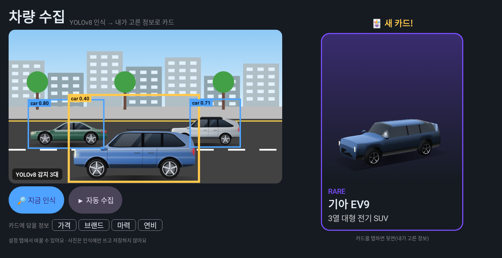 | 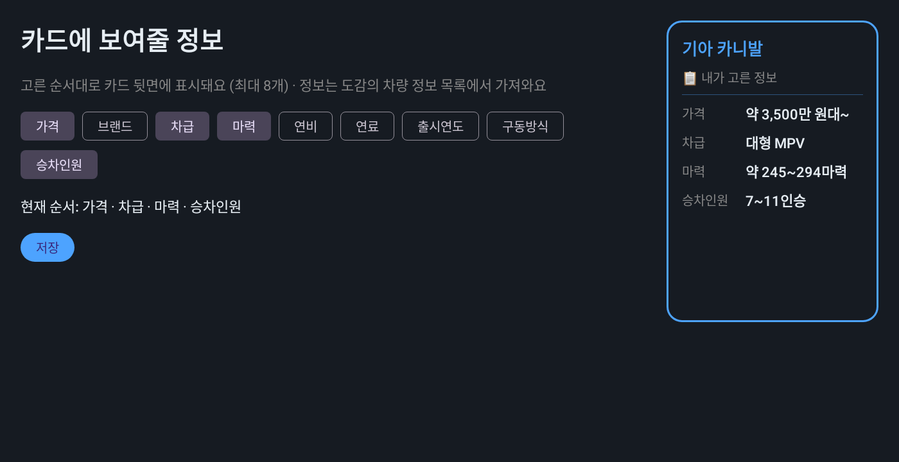 |

- **수집 탭**: 마지막 분석 화면 + 모든 감지 박스, 지금 인식 / 자동 수집, 카드에 담을 정보(키워드), 결과 카드(새 카드 / 재회)
- **새 카드 연출**: 전설 🌟 · 희귀 💎 는 축하 화면, 일반은 알림 (주행 중엔 음성만)
- **정보는 목록에서만**: 카드 뒷면 정보는 `backend/app/data/vehicle_catalog.json`(28종 × 9항목: 가격·브랜드·차급·마력·연비·연료·출시연도·구동방식·승차인원)에서 그대로 꺼냄. 고를 수 있는 항목도 이 9개뿐 (`GET /api/v1/preferences/fields`)
- **도감에 없는 차량**: 목록 28종 밖의 차량은 카드를 만들지 않고 "도감에 없는 차량이에요"로 안내
- **판별 재사용**: 같은 차(모습이 거의 같거나, 위치가 겹치면서 모습도 비슷)를 30초 안에 다시 보면 Claude 비전 판별을 다시 하지 않음 → 영상 입력 시 비용·지연 절감 (앞차가 바뀌면 다시 판별)

수집 방법(차량 영상 입력 경로)은 미정이며, 어떤 입력이든 다음 흐름으로 카드가 됩니다.

**YOLOv8 차량 인식 → 차종 판별(28종 중) → 차량 정보 목록에서 내가 고른 항목 → 카드 (앞면: 차량 일러스트 / 뒷면: 정보) → 도감 등록**

- 차종 판별은 지금 Claude 비전이 **28종 목록 중 하나를 고르는 용도로만** 사용 (정보 생성 X). 시연 차종 사진으로 YOLO 를 추가 학습하면 AI 없이 판별 가능
- 차량 정보 수치는 대략적인 예시값 → 시연 전 공식 자료로 검수

## 아이용 차 맞히기 퀴즈 (퀴즈 탭)

| 문제 (대답 전엔 가림) | 정답 공개 |
|---|---|
| 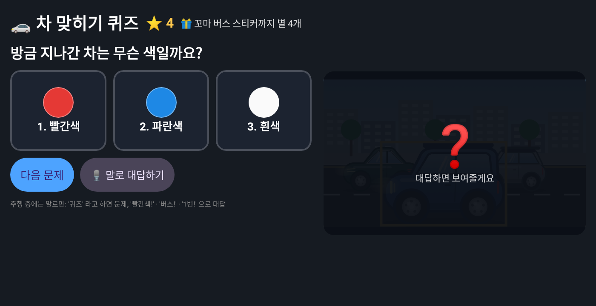 | 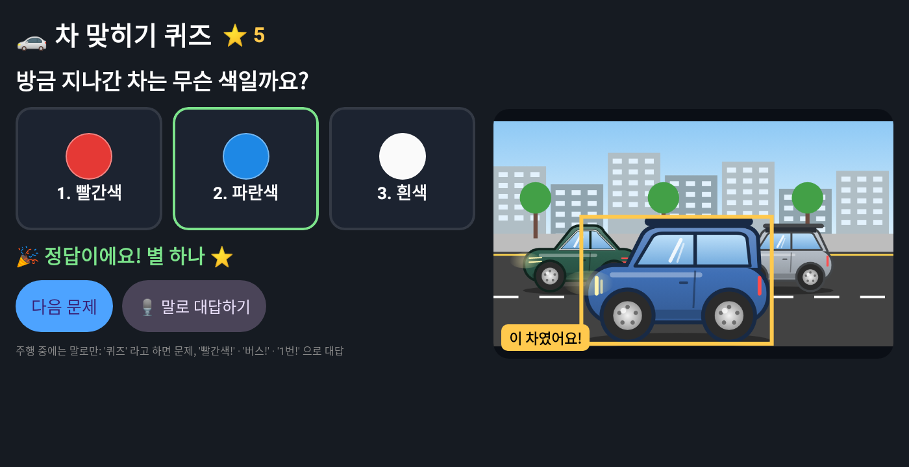 |

- "방금 지나간 차는 **무슨 색**일까요? / **어떤 차**일까요?" — 3지선다, 맞히면 ⭐ (서버에 누적, 문제당 1개)
- 별이 모이면 **쇼룸 스티커**(🐶 1 · 🚒 3 · 🚓 5 · 🚌 8 · 🦖 12 · 🌈 16 · 🚀 20) 해금 — 랭킹 점수와는 분리
- **YOLOv8 결과만으로 출제** (차종 판별 AI 불필요): 종류 = YOLO 클래스(승용차·버스·트럭·오토바이), 색깔 = 잘라낸 차량의 차체 영역 대표 색(HSV, 9색)
- 정차 중엔 큰 버튼, **주행 중엔 말로만** — Pleos SpeechToText 로 "퀴즈"(다음 문제), "빨간색!" · "버스!" · "1번!"(대답), 문제·결과는 Pleos TTS 로 읽어 줌. 주행 모드 화면에는 문제와 보기만 크게 표시
- API: `POST /api/v1/quiz/question` (multipart `image`, 선택 `type=kind|color`)

## 차량 인식 (베타) 검증 현황


| 단계 | 상태 |
|---|---|
| ① YOLOv8 차량 감지 | ✅ 백엔드 API(`/recognize`, `/recognize/video`)로 실제 실행 확인 — COCO 샘플 사진에서 버스 0.80~0.94·승용차 0.64 감지, 사람만 있는 사진은 '차량 없음', 4초 패닝 영상에서 같은 차를 1대로 추적. 위 장면(직접 그린 도로)에서 car 0.80 / 0.71 / 0.40 |
| ② 가장 가까운 차 선택·잘라내기 | ✅ 확인 |
| ③ 차종 판별 (Claude 비전, 28종 중 선택) | ⏳ API 키 연동 후 확인 필요 (지금은 mock) |
| ④ 카드 정보 (차량 정보 목록 조회) | ✅ 백엔드 테스트로 확인 |
| ⑤ 도감 등록 (신규/재발견) | ✅ 백엔드 테스트로 확인 |

- YOLO 객체 추적(`model.track`)에는 `lap` 패키지가 필요해 `requirements-vision.txt` 에 추가. 없으면 IoU 기반 대체 추적으로 자동 전환
- 감지 장면 재생성: `python scripts/detect_demo_scene.py <이미지> <출력.json>` (백엔드의 실제 감지 코드 사용)

## 화면

| 여행 홈 (한눈에 보기 + 챌린지 + 히든 스탬프) | 주행 모드 (화면 잠금 + 음성 안내) |
|---|---|
|  |  |
| **랭킹 · 지역 마스터** | **성취 축하** |
|  |  |
| **첫 실행 안내 (권한 사용 목적 설명)** | **AI 코스 추천** |
|  |  |

- 첫 실행: 안내 3장(서비스 소개 · 쇼룸 · 안전/위치 사용 목적) → 마지막에 Pleos 권한 요청
- 여행 탭 상단 '나의 여행': 시너지·주간 순위·스탬프·쇼룸 아이템 + **다음 목표 한 줄**(진행 중 코스 → 가장 가까운 지역 마스터 → 다음 순위)
- 코스 완주 · 축제 배지 · 지역 마스터 등극 시 축하 연출 (주행 중엔 음성만, 화면 연출은 정차 후)
- 서버 연결이 끊기면 하단 배너 + 다시 시도, 오류는 사용자 문구로 표시
- 스크린샷 재생성: `cd android && ./gradlew testDebugUnitTest --tests '*ScreenshotTest*'` → `app/build/screenshots/`

## 쇼룸 디자인

> **실제 차량 보기 (제조사 공식 이미지 · 360° 회전)**: 카드 앞면·도감·쇼룸에 현대·기아·제네시스 공식 사이트의 실제 차량 이미지를 보여줍니다.
> 현대 11종(60프레임)·기아 10종(72프레임)은 **드래그로 360° 회전**, 제네시스 5종·캐스퍼·카니발은 각도별 사진 넘기기. 쇼룸에서는 턴테이블과 함께 돌아갑니다.
> **내가 본 색 그대로**: 인식할 때 차체 색(9색)을 재서 공식 색상(147가지) 중 가장 가까운 색으로 카드를 보여줍니다. 카드 위 색상 칩으로 바꿀 수 있고(`PUT /api/v1/collection/{id}/color`), 쇼룸에도 같은 색으로 전시됩니다.
> **컬러 컬렉션**: 같은 모델을 다른 색으로 만나면 '만난 색'에 쌓이고, 3색 이상이면 모델당 🎨 컬러 컬렉터 +15 — 더 많이 달리지 않아도 수집할 거리가 늘어납니다.
> 데이터 절약: 처음엔 보이는 각도 1장만 받고, 손가락으로 돌리기 시작할 때 나머지 프레임을 받습니다.
> 이미지는 저장소·APK에 넣지 않고 URL 목록(`assets/vehicle_images.json`)만 두어 실행 중 내려받아 캐시합니다 (오프라인이면 3D 모델로 대체).
> ⚠️ **저작권은 각 제조사에 있습니다. 비상업 프로토타입 용도이며, 상업화 전 사용 허락을 받거나 교체해야 합니다.** 수집 방법: `scripts/official_images/`
>
> 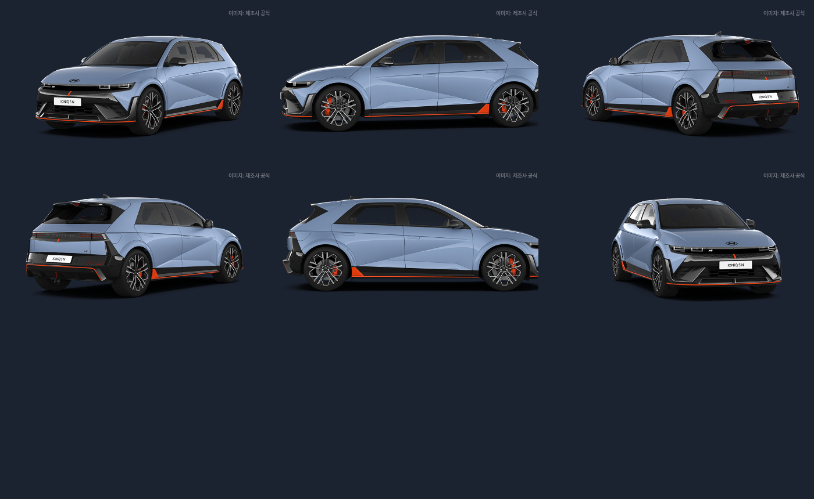
>
> **(대체) 차량 일러스트**: 외곽선 없는 메탈릭 도장 반사·틴팅 유리·알로이 휠로 28종을 코드로 그립니다 (`RealCarArt.kt`). 로고·번호판은 그리지 않아 상표·개인정보 문제가 없고, 이전 카툰 버전(`drawToyCar`)도 보관.
>
> **무료 에셋 적용**: 바닥은 Poly Haven 실사 질감(CC0)을 원근 변환으로 타일링, 소품·스탬프 아이콘은 Twemoji(CC BY 4.0)로 통일 → 기기 폰트와 상관없이 같은 그림체. 출처: [`docs/ASSET_CREDITS.md`](docs/ASSET_CREDITS.md)

| 우드 데크 + 친환경 소품 | 골드 마블 + 지역 마스터 |
|---|---|
| 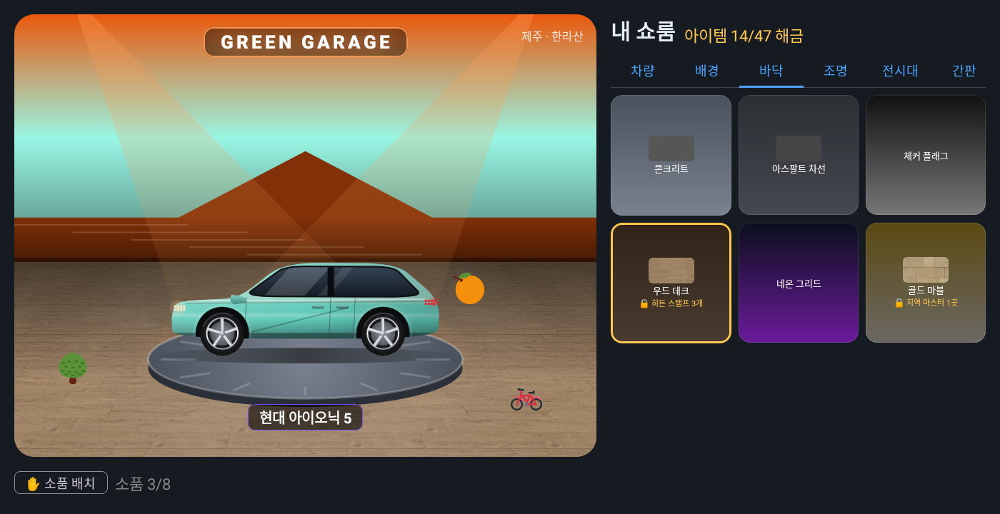 | 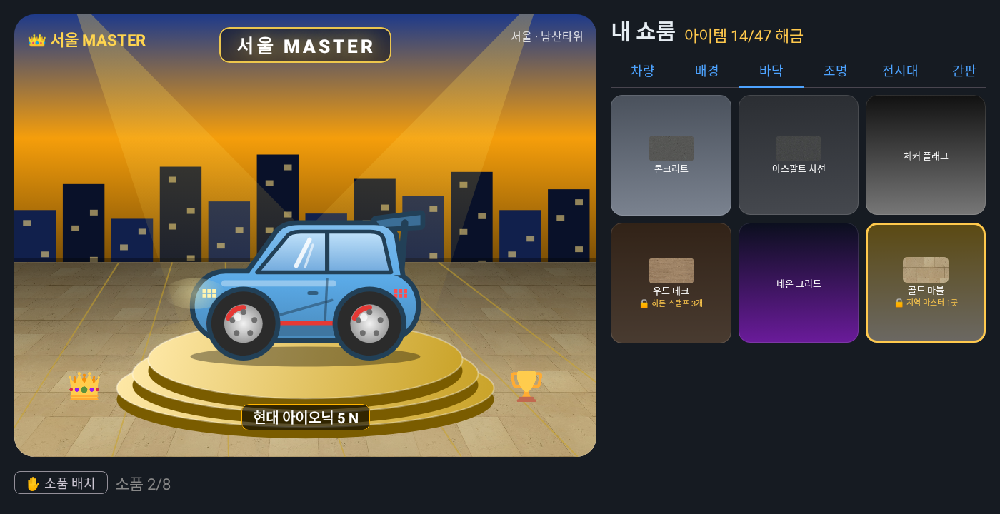 |

차고 꾸미기라는 방식만 참고한 **자체 디자인**입니다 (특정 게임의 그래픽·명칭·에셋 미사용). 모든 그래픽은 Compose Canvas 로 직접 그립니다.

| 부산 마스터 (체커 바닥 · 골드 포디움 · 골드 조명) | 강원 (네온 그리드 · 네온 링 · 오로라 조명) |
|---|---|
|  |  |

| 슬롯 | 아이템 (해금 조건 예시) |
|---|---|
| 배경 | 기본 차고 + 지역 스탬프 17곳의 풍경 (도시·바다·산·한옥·섬·들판·호수·대교·성곽) |
| 바닥 | 콘크리트 / 아스팔트 차선(스탬프 2) / 체커(코스 완주 1) / 우드(히든 3) / 네온 그리드(시너지 300) / 골드 마블(마스터 1) |
| 조명 | 화이트 / 선셋(스탬프 3) / 오션(히든 1) / 오로라(축제 배지 1) / 챔피언 골드(마스터 1) |
| 전시대 | 기본 턴테이블 / 네온 링(완주 1) / 골드 포디움(마스터 1) — 회전 애니메이션 |
| 네온 간판 | MY GARAGE / ROAD TRIPPER(스탬프 5) / CAR COLLECTOR(시너지 200) / `OO MASTER`(마스터) |
| 소품 (최대 8, 드래그·크기 조절) | 깃발·풍선·체커기·카메라·지도·벚꽃·불꽃·메달·트로피·왕관·별 + 지역 랜드마크 17종 |

- 전시대 위 차량은 **둥글둥글한 카툰 일러스트**. 시연 차종 6종은 실제 차의 알아볼 수 있는 특징(비율·램프 모양·루프랙·윙 등)만 살렸고 **로고·엠블럼은 그리지 않음**. 그 외 차량은 차체 유형 + 희귀도 색 기본형. 실제 도감 사진은 벽의 폴라로이드 액자

  

  | 차종 | 일러스트 특징 |
  |---|---|
  | 현대 아이오닉 5 | 짧은 해치백 비율, 픽셀 램프, 사선 캐릭터 라인 |
  | 기아 EV9 | 박스형 대형 SUV, 세로 램프, 루프랙 |
  | 제네시스 G80 | 길고 낮은 세단, 두 줄 램프, 크롬 창틀 |
  | 현대 그랜저 | 세단, 앞을 가로지르는 일자 LED·일자 테일램프 |
  | 기아 쏘렌토 | SUV, 세로 램프, 투톤 지붕, 루프랙 |
  | 현대 아이오닉 5 N (전설) | 낮은 차체, 리어 윙, 빨간 포인트 라인·캘리퍼, 큰 휠 |
| 그 외 22종 | 아반떼(N)·쏘나타·투싼·팰리세이드·캐스퍼·아이오닉 6·스타리아·코나·모닝·레이·K5·K8·스포티지·셀토스·카니발·EV3·EV6·G90·GV70·GV80·GV60 — 차체 비율·램프·색으로 구분 |
- 마스터 칭호를 잃으면 마스터 전용 아이템은 자동으로 기본 아이템으로 돌아감 → 칭호를 지키러 다시 방문

## Pleos Playground 에서 쓰는 것

| 항목 | 내용 |
|---|---|
| SDK 저장소 | `https://nexus-playground.pleos.ai/repository/maven-releases/` (공식 샘플과 동일) |
| FusedLocation SDK | `ai.pleos.playground:FusedLocation:1.1.3`, 권한 `pleos.car.permission.FUSED_LOCATION` — 지역 스탬프 획득 + 도감의 '발견 장소' |
| NaviHelper SDK | `ai.pleos.playground:NaviHelper:3.0.5`, 권한 `NAVI_ROUTE`·`NAVI_ROUTE_SEARCH` — AI 코스 길안내 (목적지 + 경유지 2곳) |
| Vehicle SDK | `ai.pleos.playground:Vehicle:2.3.2`, 권한 `CAR_DRIVE` — `Odometer.getTripCurrentDrivingDistance/Time` 으로 주차 시 주행 리포트(단위는 실차 확인 필요) · 기어(P단) 상태 (보조: SDK 에서 기어 API 가 deprecated 되어 아래 표준 API 를 우선 사용) |
| Android Automotive 표준 | `CarUxRestrictionsManager` — 차량이 알려주는 '주행 중 UX 제한' 으로 **주행 중 화면 잠금** (1순위) |
| **LLM SDK** | `ai.pleos.playground:LLM:2.1.3.2`, 권한 `LLM_SERVICE` — **AI 드라이브 코스 추천을 Pleos LLM 이 선택** (서버가 후보·프롬프트 제공 → Pleos LLM 선택 → 서버가 시간·점수 재계산). 못 쓰면 서버 추천으로 대체 |
| **SpeechToText SDK** | `ai.pleos.playground:SpeechToText:3.3.1`, 권한 `STT_SERVICE` + `RECORD_AUDIO` — **주행 중 음성 명령** ('길안내', '인식', '순위', '도감') |
| TextToSpeech SDK | `ai.pleos.playground:TextToSpeech:3.3.1` (ON_DEVICE), 권한 `TTS_SERVICE` — 스탬프·코스 알림 **음성 안내** (실패 시 안드로이드 기본 TTS) |
| 서라운드뷰/카메라 | 공개 API 미확인 → 영상 직접 입력으로 대체 |

> **빌드 확인**: Pleos SDK(FusedLocation 1.1.3, NaviHelper 3.0.5, Vehicle 2.3.2, TextToSpeech 3.3.1)를 실제로 받아
> `./gradlew assembleDebug` 컴파일과 `./gradlew lintDebug`(오류 0건)까지 통과했습니다. 에뮬레이터/실차에서의 동작 확인은 아직입니다.

## 운전자 안전 설계
- **주행 모드**: 주행 중(① Android Automotive 표준 주행 중 UX 제한 → ② Pleos 기어 ≠ P → ③ 위치 기반 속도 5초 평균 8km/h 이상, 순서대로 사용)에는 모든 조작 화면을 잠그고,
  큰 글씨의 정보(챌린지 진행률·다음 장소·가까운 히든 스탬프·랭킹)와 **"남은 곳 길안내" 버튼 하나**만 보여줍니다. 정차(P단)하면 전체 기능이 열립니다.
- **음성 안내**: 스탬프 획득·코스 진행·완주 알림을 Pleos TTS 로 읽어줘 화면을 볼 필요가 없습니다 (주행 모드에서 끄기 가능).
- **속도 경쟁 없음**: 랭킹·마스터는 방문·수집 점수로만 계산합니다.
- **위치 정보 최소화**: 서버에는 지역 판정·명소 반경 확인에 필요한 좌표만 보내고, 이동 경로는 저장하지 않습니다(도감의 '최초 발견 위치'만 저장).
- **이미지 미저장**: 차량 사진(번호판 등이 찍힐 수 있음)은 인식에만 쓰고 저장하지 않습니다. 카드 앞면은 일러스트라 사진이 필요 없습니다 (`SAVE_CROPS=true` 일 때만 디버그용 저장).
- 시연용: 디버그 빌드의 여행 탭에 `🚗 주행 모드 시연` 버튼 (에뮬레이터에서 기어를 바꾸기 어려울 때)

> **Playground 앱 ID/키 (LLM·음성 인식 서버 모드)**: Pleos Playground 'My Project' 에서 앱을 등록해 받은 앱 ID/키를
> `android/local.properties` 에 `pleos.appId=...`, `pleos.appKey=...` 로 넣으면 `registerApp()` 으로 서버 모드를 씁니다 (저장소에 올리지 말 것).
> 없으면 기기(ON_DEVICE) 모드로 동작합니다.
>
> **차종 판별과 Pleos LLM**: LLM 2.1.3.2 공개 API 는 텍스트 입력만 열려 있고 이미지 입력(`ImagePart`)은 SDK 내부용이라,
> 차종 판별에는 쓰지 않았습니다 (공개되지 않은 기능 우회 사용 X). 차종 판별은 서버(28종 중 선택) → 추후 YOLO 추가 학습으로 대체 예정.

> **API 키 관련 메모**: 공식 FusedLocation 샘플 기준, 차량 내 SDK(FusedLocation/Vehicle)는 별도 API 키 없이
> Maven 의존성 + 권한으로 동작합니다. Playground 에서 발급하는 *Vehicle Data API* 키는 내 차량의 커넥티드
> 데이터를 클라우드 REST 로 받는 용도(개인 발급은 현재 유럽 한정)라 주변 차량 인식과는 무관합니다.
> LLM API 키(`ANTHROPIC_API_KEY`)는 **차종 판별(28종 중 선택)과 AI 코스 추천**에만 씁니다. 카드 정보는 목록에서 가져옵니다.

## 구조

```
pleos_car_dex/
├── backend/                         FastAPI
│   ├── app/
│   │   ├── routers/                 recognize(이미지·영상) / collection(+시너지) / showroom / stamps / preferences
│   │   ├── services/
│   │   │   ├── detector.py          YOLOv8 감지·크롭·영상 트래킹
│   │   │   ├── identifier.py        차종 식별 (Claude 비전 / mock)
│   │   │   ├── summarizer.py        카드 정보: 차량 정보 목록에서 고른 항목 조회 (AI 미사용)
│   │   │   ├── synergy.py           시너지 점수
│   │   │   ├── pipeline.py          전체 흐름 (+ 방금 본 차량은 차종 판별 재사용)
│   │   │   ├── regions.py / stamps.py  위치 → 지역 스탬프 판정·스탬프북
│   │   │   ├── store.py             도감·설정·쇼룸·스탬프 JSON 저장소
│   │   │   ├── catalog.py / llm.py
│   │   └── data/                vehicle_catalog.json(시연 차종 6종), regions.json(17개 시·도 스탬프·배경 테마)
│   └── tests/test_api.py            mock 모드 E2E (이미지·영상·시너지·스탬프·쇼룸)
├── android/                         Pleos Connect 앱 (Kotlin/Compose)
│   └── app/src/main/
│       ├── assets/demo_video/       ← 시연 주행 영상 demo_drive.mp4
│       ├── assets/demo_frames/      ← (대체) 시연 이미지
│       └── java/com/pleos/cardex/
│           ├── pleos/VehicleContext.kt  Pleos FusedLocation 위치·근접 알림 (+목업 대체)
│           ├── pleos/GearMonitor.kt     Pleos Vehicle SDK 기어 → 주행 모드
│           ├── pleos/VoiceGuide.kt      Pleos TTS 음성 안내
│           ├── pleos/PleosNavi.kt       Pleos NaviHelper 길안내
│           ├── pleos/FrameSource.kt     영상 프레임 입력 (서라운드뷰 연계 지점)
│           ├── data/                    Retrofit API
│           └── ui/                      여행(코스·챌린지·히든) / 랭킹 / 쇼룸 / 도감 / 인식(베타) / 키워드 / 주행 모드
└── scripts/demo_request.sh
```

## 빠른 시작

### 백엔드
```bash
cd backend
python -m venv .venv && source .venv/bin/activate
pip install -r requirements-vision.txt     # YOLOv8 포함 (mock 만 쓸 거면 requirements.txt)
cp .env.example .env                       # ANTHROPIC_API_KEY(LLM), TOUR_API_KEY(공공데이터포털) 입력 — 비우면 mock
uvicorn app.main:app --host 0.0.0.0 --port 8000
# 영상 통째 테스트
curl -F "video=@drive.mp4" http://localhost:8000/api/v1/recognize/video
```
완전 오프라인 시연: `DETECTOR_MODE=mock IDENTIFIER_MODE=mock USE_MOCK_LLM=true` (파일명으로 차종 결정).
**시연 도구** (`DEMO_MODE=true`): 앱 **설정 탭 → 시연 데이터 채우기**(차량 4 · 지역 스탬프 3 · 히든 2) / **전체 초기화**(영상 재촬영용) / 주행 모드 시연. API: `POST /api/v1/demo/seed`, `POST /api/v1/demo/reset`
테스트: `python -m pytest -q`

**TourAPI 키 발급**: 공공데이터포털(data.go.kr)에서 '한국관광공사_국문 관광정보 서비스_GW' 활용신청 → 일반 인증키(Decoding)를 `TOUR_API_KEY` 에 입력.
키가 없으면 `app/data/mock_attractions.json`(전국 명소 19곳 + 시연용 축제 5개)으로 동작합니다.

### Pleos 앱
1. Android Studio 로 `android/` 열기 (또는 `./gradlew assembleDebug`) → Pleos Connect 에뮬레이터 실행
2. `assets/demo_video/demo_drive.mp4` 에 주행 영상 넣기
3. 실행 → Pleos 권한(위치·기어·내비) 허용 (지원 안 되는 환경이면 자동으로 목업 위치)
   앱은 **여행 탭**에서 시작합니다. 차량 인식은 `인식(베타)` 탭 — 차량 영상 API 공개 후 확장 예정
4. 수집 탭: 영상 재생 중 `자동 수집` → 차량 카드 등장, 탭하면 뒤집혀 내가 고른 정보
5. 도감 탭: 시너지 점수 확인, `쇼룸에 전시` 로 대표 차량 지정
6. 쇼룸 탭: 대표 차량 무대 + 획득한 지역 스탬프로 배경/스티커 꾸미기, 스탬프북 확인
   (에뮬레이터에서 `adb emu geo fix 129.07 35.17` 로 부산 이동 → 부산 스탬프 획득)
7. 여행 탭: 왕복 시간·취향 선택 → `코스 추천받기` → `🏁 챌린지 시작 + Pleos 길안내` → 장소 방문할 때마다 진행률, 완주 시 보너스/한정 배지
   랭킹 탭: 이번 주 순위, 지역 마스터 현황 (몇 점 더 모으면 마스터인지)
   우측 '주변 히든 스탬프'에서 명소 거리 확인 (`adb emu geo fix 129.1604 35.1587` → 해운대 히든 스탬프)
8. 키워드 탭: 항목 변경 → 다음 인식부터 카드 뒷면 변경

에뮬레이터 → 호스트 백엔드 주소는 `http://10.0.2.2:8000/` (기본값). 다른 주소: `./gradlew assembleDebug -PapiBaseUrl=http://192.168.0.10:8000/`
(디버그 빌드는 LAN HTTP 허용, 릴리스 빌드는 에뮬레이터 주소만 허용 — 배포 시 HTTPS 필요)
에뮬레이터 위치 테스트: `adb emu geo fix 127.0276 37.4979` (경도 먼저).

## API

| Method | Path | 설명 |
|---|---|---|
| POST | `/api/v1/recognize` | 프레임 1장 + `lat`,`lon`,`keywords` → 카드 + 화면 속 모든 감지(`detections`) |
| POST | `/api/v1/recognize/video` | 주행 영상 → 차량별 카드 (최대 `VIDEO_MAX_VEHICLES`) |
| GET | `/api/v1/collection` | 도감 + 시너지 점수 |
| DELETE | `/api/v1/collection/{id}` | 도감 삭제 |
| GET / PUT | `/api/v1/showroom` | 쇼룸 조회 / `{card_id, background_region_id, floor_id, light_id, pedestal_id, sign_id, props[{item_id,x,y,scale}]}` 변경 (해금된 것만) |
| GET | `/api/v1/showroom/items` | 꾸미기 아이템 전체 + 해금 여부·조건 |
| GET | `/api/v1/stamps` | 스탬프북 (17개 시·도, 미획득 포함) |
| POST | `/api/v1/stamps/visit` | `{lat, lon}` 방문 보고 → 새 지역이면 스탬프 획득 (인식 요청에 위치가 있어도 자동 기록) |
| GET | `/api/v1/landmarks/nearby?lat&lon&radius_m` | 주변 TourAPI 명소·진행 중 축제 (획득 여부·점수) |
| POST | `/api/v1/landmarks/{content_id}/visit` | `{lat, lon}` 근접 진입 보고 → 반경 검증 후 히든 스탬프 |
| POST | `/api/v1/courses/recommend` | `{lat, lon, max_hours, date?, note?, eco?}` (eco=저탄소 코스) → AI 드라이브 코스 (서버 선택, 이동 시간·예상 점수는 서버 계산) |
| POST | `/api/v1/courses/candidates` | 앱의 **Pleos LLM** 용: 후보 목록 + 프롬프트 + 규칙 기반 대체 선택 |
| POST | `/api/v1/courses/build` | Pleos LLM 이 고른 후보 ID 로 코스 조립 (후보 밖 ID 제거, 시간·점수 서버 계산) |
| GET | `/api/v1/preferences/fields` | 카드 뒷면에 고를 수 있는 항목 (차량 정보 목록 9항목) |
| POST / GET / DELETE | `/api/v1/challenge` | 코스 챌린지 시작(`DriveCourse` 그대로) / 현재 상태 / 포기 |
| GET | `/api/v1/rankings/weekly?region_id=` | 이번 주 랭킹 (내 순위, 윗 순위까지 남은 점수) |
| GET | `/api/v1/rankings/masters` | 이번 달 시·도별 지역 마스터, 내 칭호 |
| GET | `/api/v1/home` | 도감 홈 요약 (도감·전설·점수·순위·스탬프·브랜드 스팟·이번 주의 차·다음 목표) |
| GET | `/api/v1/daily` | 이번 주의 차 미션(주 번호·남은 날·전기차 주간) + 연속 기록 + 차 쉬는 날 |
| POST | `/api/v1/daily/checkin` | 앱 실행 시 출석(운전 불필요) + 지난 '차 쉬는 날' 정산 (최근 14일, 1일 +10) |
| POST | `/api/v1/trips/report` | `{started_at, distance_km, drive_minutes, source}` 주차 시 주행 리포트 (이번 주행에서 모은 카드·스탬프·점수 + TTS 문구) |
| GET / POST | `/api/v1/quiz/stars` · `/api/v1/quiz/star` | 퀴즈 별·다음 스티커 / `{question_id}` 정답 별 +1 |
| POST | `/api/v1/demo/seed` · `/api/v1/demo/reset` | 시연 데이터 채우기 / 초기화 (`DEMO_MODE=true` 일 때만) |
| GET / PUT | `/api/v1/preferences` | 유저 키워드(최대 8개) |

## LLM 설정 메모 (차종 판별 · 코스 추천에만 사용)
- `claude-opus-5-5`, 구조화 출력, 응답성을 위해 `LLM_EFFORT=low`
- 차종 판별은 28종 목록 중에서만 고르게 하고, 카드 정보는 목록에서 조회 → AI 가 수치를 지어낼 여지 없음
- 안전 필터 거절 시 서버 측 자동 재시도(`fallbacks="default"`), 최종 실패 시 mock
- 같은 차량을 2분 안에 다시 보면 저장된 카드 재사용
- 카탈로그 수치는 예시값 — 시연 전 검수 필요
- 코스 추천: LLM 은 서버가 모은 후보 ID 중에서만 고르게 하고(없는 장소 지어내기 방지), 이동 시간·점수는 서버가 계산. 희망 시간을 넘으면 경유지를 자동으로 줄임. LLM 이 없으면 규칙 기반 추천
- 지역 판정은 시·도 중심좌표 최근접(반경 60km) 근사 — 경계 부근은 부정확할 수 있음 (역지오코딩으로 교체 가능)
